# 12 — คู่มืออธิบายโค้ด สำหรับคนอัดวิดีโอ (ฉบับเข้าใจง่าย)

> เขียนให้คนที่ **ไม่เคยเขียนโค้ด** อ่านแล้วอธิบายโปรแกรมนี้ในวิดีโอได้เอง
> โค้ดทุกชิ้นในคู่มือ **ยกมาจากไฟล์จริงไม่ตัดทอน** พร้อมเลขบรรทัด ตัวเลขทุกตัวรันจากโปรแกรมจริงแล้ว ภาพทุกภาพแคปจากเว็บจริง
>
> - เว็บจริง: **https://cpu-scheduling.s3rx.net**
> - โค้ดบน GitHub: **https://github.com/serlorsx-xln/cpu-scheduling-simulator** (ลิงก์ 🔗 ในคู่มือ กดแล้วจะเปิดไฟล์และไฮไลต์บรรทัดนั้นให้เลย)

---

## หน้าแรก: อ่านหน้านี้ก่อน

**โปรแกรมนี้คืออะไร** — เว็บที่จำลองว่า CPU ควรทำงานให้โปรเซสไหนก่อน-หลัง ด้วย 3 วิธี (FCFS, SJF, Round Robin) แล้วคำนวณว่าแต่ละโปรเซส **รอนานแค่ไหน** เพื่อดูว่าวิธีไหนดีที่สุดกับข้อมูลชุดนั้น

**กฎข้อเดียวที่ต้องจำ** — ทุกโปรเซส **มาถึงพร้อมกันที่เวลา 0** (โจทย์กำหนด) เลยไม่มีใครมาแทรกกลางทาง

**ตัวเลขที่ควรจำ (ชุด SET-A: P1 = 5, P2 = 3, P3 = 8, q = 2)**

| | FCFS | SJF | Round Robin |
|---|---|---|---|
| เวลารอเฉลี่ย (AVG WT) | 4.33 | **3.67 (ดีที่สุด)** | 7.00 |

**6 หัวข้อที่อาจารย์ให้พูด อยู่ตรงไหนในคู่มือนี้**

| # | หัวข้อในวิดีโอ | อ่านบทที่ | เปิดไฟล์ไหนตอนอัด |
|---|---|---|---|
| ① | หลักการ FCFS / SJF / RR | [บท 1](#บทที่-1-หลักการของ-3-อัลกอริทึม-เล่าแบบร้านข้าว) | — (ใช้เว็บ) |
| ② | โครงสร้างโปรแกรมและโค้ดสำคัญ | [บท 2](#บทที่-2-โครงสร้างโปรแกรม-เปรียบเป็นร้านอาหาร) + [บท 4](#บทที่-4-โค้ดคำนวณ-อ่านทีละบรรทัด) | `fcfs.ts` `sjf.ts` `rr.ts` `simulate.ts` |
| ③ | รับจำนวนโปรเซส / BT / Quantum | [บท 3](#บทที่-3-การรับข้อมูล-และการกันค่าผิด) | `validation.ts` |
| ④ | คำนวณและแสดง ST / CT / TAT / WT / AVG WT | [บท 4.6](#46-คำนวณ-tat-wt-avg-wt--libschedulingsimulatets-บรรทัด-1248) + [บท 5](#บทที่-5-การแสดงผลบนหน้าจอ) | `simulate.ts` |
| ⑤ | ทดสอบด้วยค่ากรอกเองและค่าสุ่ม | [บท 6](#บทที่-6-การทดสอบ) | — (ใช้เว็บ) |
| ⑥ | เปรียบเทียบเมื่อ BT / Quantum เปลี่ยน | [บท 7](#บทที่-7-เปรียบเทียบเมื่อ-burst-time-หรือ-quantum-เปลี่ยน) | — (ใช้เว็บ) |

สคริปต์ถ่ายทีละฉากพร้อมบทพูดอยู่ที่ [บทที่ 8](#บทที่-8-สคริปต์ถ่ายคลิป-ทีละฉาก)

**ลำดับการอ่านที่แนะนำ:** บท 0 (ปูพื้นภาษาโค้ด) → บท 1 → บท 2 → แล้วค่อยอ่านบทอื่นตามลำดับ

---

## สารบัญ

- [บทที่ 0: ปูพื้นภาษาโค้ด 15 นาที](#บทที่-0-ปูพื้นภาษาโค้ด-15-นาที)
- [บทที่ 1: หลักการของ 3 อัลกอริทึม (เล่าแบบร้านข้าว)](#บทที่-1-หลักการของ-3-อัลกอริทึม-เล่าแบบร้านข้าว)
- [บทที่ 2: โครงสร้างโปรแกรม (เปรียบเป็นร้านอาหาร)](#บทที่-2-โครงสร้างโปรแกรม-เปรียบเป็นร้านอาหาร)
- [บทที่ 3: การรับข้อมูล และการกันค่าผิด](#บทที่-3-การรับข้อมูล-และการกันค่าผิด)
- [บทที่ 4: โค้ดคำนวณ อ่านทีละบรรทัด](#บทที่-4-โค้ดคำนวณ-อ่านทีละบรรทัด)
- [บทที่ 5: การแสดงผลบนหน้าจอ](#บทที่-5-การแสดงผลบนหน้าจอ)
- [บทที่ 6: การทดสอบ](#บทที่-6-การทดสอบ)
- [บทที่ 7: เปรียบเทียบเมื่อ Burst Time หรือ Quantum เปลี่ยน](#บทที่-7-เปรียบเทียบเมื่อ-burst-time-หรือ-quantum-เปลี่ยน)
- [บทที่ 8: สคริปต์ถ่ายคลิป ทีละฉาก](#บทที่-8-สคริปต์ถ่ายคลิป-ทีละฉาก)
- [บทที่ 9: คำถามที่อาจารย์อาจถาม](#บทที่-9-คำถามที่อาจารย์อาจถาม)
- [บทที่ 10: ศัพท์ที่ต้องรู้](#บทที่-10-ศัพท์ที่ต้องรู้)
- [ภาคผนวก: เปิดโค้ดและรันโปรแกรมในเครื่อง](#ภาคผนวก-เปิดโค้ดและรันโปรแกรมในเครื่อง)

---

## บทที่ 0: ปูพื้นภาษาโค้ด 15 นาที

โปรแกรมเขียนด้วยภาษา **TypeScript** ไม่ต้องเขียนเป็น แค่ **อ่านออก** ก็พอ ข้างล่างคือทุกอย่างที่โผล่ในโค้ดส่วนสำคัญ

### 0.1 ตัวแปร = กล่องที่มีชื่อ

```ts
let t = 0;
```

แปลว่า "สร้างกล่องชื่อ `t` ใส่เลข 0 ไว้" — ในโปรแกรมนี้ `t` คือ **นาฬิกา** บอกว่าตอนนี้เวลาเท่าไร

- `let` = กล่องที่เปลี่ยนค่าได้ภายหลัง
- `const` = กล่องที่ตั้งชื่อแล้วไม่เปลี่ยนไปเป็นกล่องอื่น
- `;` ท้ายบรรทัด = จบประโยค (เหมือนจุด)

### 0.2 Array = แถวของกล่อง และ **เลขช่องเริ่มที่ 0**

```ts
burstTimes = [5, 3, 8]
```

| เลขช่อง (index) | 0 | 1 | 2 |
|---|---|---|---|
| ค่า | 5 | 3 | 8 |
| คือโปรเซส | **P1** | **P2** | **P3** |

⚠️ **สำคัญที่สุดในบทนี้:** คอมพิวเตอร์นับช่องจาก 0 แต่คนนับโปรเซสจาก 1 → P1 อยู่ช่อง 0 เลยเห็น **`i + 1`** อยู่ทั่วโค้ด แปลว่า "แปลงเลขช่องเป็นเลขโปรเซส" เช่น ช่อง 0 → P1

- `burstTimes[0]` = ค่าในช่อง 0 = 5
- `burstTimes.length` = มีกี่ช่อง = 3

### 0.3 วนซ้ำ (loop)

```ts
for (let i = 0; i < burstTimes.length; i++) { ... }
```

แปลว่า "เริ่ม `i` = 0 · ทำสิ่งที่อยู่ใน `{ }` · เพิ่ม `i` ทีละ 1 (`i++`) · ทำซ้ำไปเรื่อย ๆ ตราบใดที่ `i` ยังน้อยกว่า 3" → ทำ 3 รอบ ด้วย i = 0, 1, 2 (คือ P1, P2, P3)

```ts
while (queue.length > 0) { ... }
```

แปลว่า "ทำซ้ำไปเรื่อย ๆ **ตราบใดที่คิวยังมีคน**"

```ts
for (const { bt, i } of order) { ... }
```

แปลว่า "หยิบของในรายการ `order` มาทีละชิ้น ชิ้นละรอบ"

### 0.4 เงื่อนไข

```ts
if (remaining[i] === 0) completionTime[i] = t;
else queue.push(i);
```

แปลว่า "**ถ้า** เวลาที่เหลือเท่ากับ 0 → บันทึกเวลาเสร็จ **ไม่อย่างนั้น** → ส่งกลับไปต่อคิว"

| เครื่องหมาย | แปลว่า |
|---|---|
| `===` | เท่ากันไหม |
| `>` `<` `>=` | มากกว่า / น้อยกว่า / มากกว่าหรือเท่ากับ |
| `!` | ไม่ (กลับค่าจริงเป็นเท็จ) |
| `&&` | และ |
| `\|\|` | หรือ (ดูการใช้แบบพิเศษใน SJF บท 4.4) |

### 0.5 ฟังก์ชัน = เครื่องจักร รับของเข้า คืนของออก

```ts
function simulateFcfs(burstTimes: number[]): AlgorithmOutput {
  ...
  return { startTime, completionTime, gantt };
}
```

แปลว่า "เครื่องชื่อ `simulateFcfs` รับ Burst Time เข้าไป แล้ว **คืน (`return`)** เวลาเริ่ม เวลาเสร็จ และ Gantt chart ออกมา"

- ส่วน `: number[]`, `: AlgorithmOutput` คือ **ป้ายบอกชนิดข้อมูล** (number[] = แถวของตัวเลข) — **ข้ามไปได้เลยตอนอ่าน** ไม่มีผลต่อการคำนวณ
- `export` ข้างหน้า = ให้ไฟล์อื่นเรียกใช้ฟังก์ชันนี้ได้

### 0.6 คำสั่งจัดการแถว (array) ที่เจอบ่อย

| คำสั่ง | แปลว่า | ตัวอย่าง |
|---|---|---|
| `queue.push(x)` | ใส่ x **ต่อท้าย** แถว | `[P2, P3]` push P1 → `[P2, P3, P1]` |
| `queue.shift()` | **หยิบตัวหน้าสุด** ออกมา | `[P1, P2, P3]` → ได้ P1, เหลือ `[P2, P3]` |
| `.map(...)` | ทำอะไรสักอย่างกับ **ทุกช่อง** ได้แถวใหม่ | `[5,3,8].map(x => x * 2)` → `[10,6,16]` |
| `.sort(...)` | **เรียงลำดับ** | ดูบท 4.4 |
| `.filter(...)` | **เก็บเฉพาะ** ช่องที่ผ่านเงื่อนไข | เก็บเฉพาะอัลกอริทึมที่ติ๊ก |
| `.reduce(...)` | **รวม** ทุกช่องเป็นค่าเดียว | ใช้หาผลรวม WT |
| `[...x]` | ถ่ายสำเนาแถว x | กันของจริงถูกแก้ |

### 0.7 คณิตศาสตร์

| คำสั่ง | แปลว่า | ตัวอย่าง |
|---|---|---|
| `Math.min(a, b)` | ตัวที่น้อยกว่า | `Math.min(2, 5)` = 2 |
| `Math.random()` | สุ่มเลข 0 ถึงเกือบ 1 | 0.73… |
| `Math.floor(x)` | ปัดลง | `Math.floor(7.3)` = 7 |
| `Math.round(x)` | ปัดเศษตามปกติ | `Math.round(366.67)` = 367 |
| `t += 2` | t = t + 2 | |
| `x -= 2` | x = x − 2 | |

### 0.8 ลูกศร `=>` = ฟังก์ชันสั้น ๆ

```ts
(x) => x * 2
```

แปลว่า "รับ x แล้วคืน x × 2" — เจอใน `.map` `.sort` `.filter`

### 0.9 คอมเมนต์ = โน้ตสำหรับคน คอมพิวเตอร์ไม่อ่าน

```ts
// ข้อความหลัง // คือคอมเมนต์
/** ข้อความในนี้ก็เป็นคอมเมนต์ */
```

ในโปรเจกต์นี้คอมเมนต์เป็นภาษาไทย อ่านคอมเมนต์ก่อนจะเข้าใจโค้ดเร็วขึ้นมาก

---

## บทที่ 1: หลักการของ 3 อัลกอริทึม (เล่าแบบร้านข้าว)

**สมมติ:** ร้านข้าวมี **พ่อครัวคนเดียว** (= CPU) ลูกค้า 3 คนมาถึง **พร้อมกัน** (= โปรเซสทุกตัว AT = 0) แต่ละคนสั่งอาหารที่ใช้เวลาทำต่างกัน (= Burst Time)

| ลูกค้า | ใช้เวลาทำ (BT) |
|---|---|
| P1 | 5 นาที |
| P2 | 3 นาที |
| P3 | 8 นาที |

คำถาม: พ่อครัวควรทำของใครก่อน ลูกค้าถึงจะ **รอน้อยที่สุดโดยเฉลี่ย**?

### 1.1 FCFS — First-Come, First-Served "มาก่อนได้ก่อน"

**แบบร้านข้าว:** ทำตามลำดับคิว P1 → P2 → P3 ทำของคนหนึ่งจนเสร็จแล้วค่อยทำคนถัดไป

```
นาที:  0         5     8                 16
       |   P1    | P2  |       P3        |
```

| ลูกค้า | ได้เริ่มทำ (ST) | เสร็จ (CT) | รอไป (WT) |
|---|---|---|---|
| P1 | 0 | 5 | 0 (ได้ทำทันที) |
| P2 | 5 | 8 | 5 (รอ P1) |
| P3 | 8 | 16 | 8 (รอ P1 + P2) |

เวลารอเฉลี่ย = (0 + 5 + 8) ÷ 3 = **4.33**

**ข้อเสีย:** ถ้าคนแรกสั่งของที่ทำนานมาก ทุกคนข้างหลังรอนานหมด (เรียกว่า **convoy effect** — เหมือนรถติดหลังรถบรรทุก)

### 1.2 SJF — Shortest Job First "งานสั้นสุดก่อน" (แบบ Non-preemptive)

**แบบร้านข้าว:** ดูว่าใครสั่งของที่ทำเร็วสุด ทำของคนนั้นก่อน (และทำจนเสร็จ ไม่สลับกลางคัน)
ถ้าสองคนใช้เวลาเท่ากัน → ทำของคนที่เลขน้อยกว่าก่อน (P1 ก่อน P2)

ลำดับ: P2 (3) → P1 (5) → P3 (8)

```
นาที:  0     3         8                 16
       | P2  |   P1    |       P3        |
```

| ลูกค้า | ST | CT | WT |
|---|---|---|---|
| P1 | 3 | 8 | 3 |
| P2 | 0 | 3 | 0 |
| P3 | 8 | 16 | 8 |

เวลารอเฉลี่ย = (3 + 0 + 8) ÷ 3 = **3.67** ← **ดีที่สุด**

**ทำไมดีที่สุด:** งานสั้นออกไปก่อน → คนที่ต้องรอนานมีแค่คนที่สั่งของนาน ซึ่งมีน้อยคน
**Non-preemptive** แปลว่าเริ่มทำแล้วต้องทำจนเสร็จ ไม่หยุดกลางคัน

### 1.3 Round Robin (RR) — "ผลัดกันคนละนิด"

**แบบร้านข้าว:** พ่อครัวทำให้คนละไม่เกิน **2 นาที** (= Time Quantum, q = 2) ครบ 2 นาทีแล้วถ้าของยังไม่เสร็จ ลูกค้าคนนั้นต้อง **ไปต่อท้ายคิวใหม่** แล้วพ่อครัวทำของคนถัดไป วนไปเรื่อย ๆ จนเสร็จทุกคน

```
นาที:  0    2    4    6    8  9   11 12   14   16
       | P1 | P2 | P3 | P1 |P2| P3 |P1| P3 | P3 |
```

ไล่ทีละช่วง (คิว = คนที่รออยู่ เรียงจากหัวไปท้าย):

| ช่วงเวลา | พ่อครัวทำของ | ทำไป | ของคนนั้นเหลือ | เกิดอะไรขึ้น | คิวหลังจากนั้น |
|---|---|---|---|---|---|
| 0–2 | P1 | 2 | 5 − 2 = 3 | ยังไม่เสร็จ → ไปต่อท้าย | P2 → P3 → P1 |
| 2–4 | P2 | 2 | 3 − 2 = 1 | ยังไม่เสร็จ → ไปต่อท้าย | P3 → P1 → P2 |
| 4–6 | P3 | 2 | 8 − 2 = 6 | ยังไม่เสร็จ → ไปต่อท้าย | P1 → P2 → P3 |
| 6–8 | P1 | 2 | 3 − 2 = 1 | ยังไม่เสร็จ → ไปต่อท้าย | P2 → P3 → P1 |
| 8–9 | P2 | **1** (เหลือแค่ 1) | 0 | **เสร็จ! CT = 9** | P3 → P1 |
| 9–11 | P3 | 2 | 6 − 2 = 4 | ยังไม่เสร็จ → ไปต่อท้าย | P1 → P3 |
| 11–12 | P1 | **1** (เหลือแค่ 1) | 0 | **เสร็จ! CT = 12** | P3 |
| 12–14 | P3 | 2 | 4 − 2 = 2 | ยังไม่เสร็จ → ไปต่อท้าย (คิวมีแค่ตัวเอง) | P3 |
| 14–16 | P3 | 2 | 0 | **เสร็จ! CT = 16** | (ว่าง) |

| ลูกค้า | ได้ทำครั้งแรก (ST) | เสร็จ (CT) | รอไป (WT) = CT − BT |
|---|---|---|---|
| P1 | 0 | 12 | 12 − 5 = 7 |
| P2 | 2 | 9 | 9 − 3 = 6 |
| P3 | 4 | 16 | 16 − 8 = 8 |

เวลารอเฉลี่ย = (7 + 6 + 8) ÷ 3 = **7.00** ← รอมากสุด

**ข้อดี:** ทุกคนได้เริ่มเร็ว (ภายใน 4 นาทีทุกคนได้ลิ้มรสแล้ว) ยุติธรรม ไม่มีใครถูกทิ้ง
**ข้อเสีย:** สลับไปมาบ่อย ทุกคนรอกันหลายรอบ เวลารอรวมเลยสูง

### 1.4 ภาพจากเว็บจริง

Gantt chart ของ FCFS (กรอบ ① คือแถว CPU บอกว่าช่วงไหนใครได้ใช้ CPU):

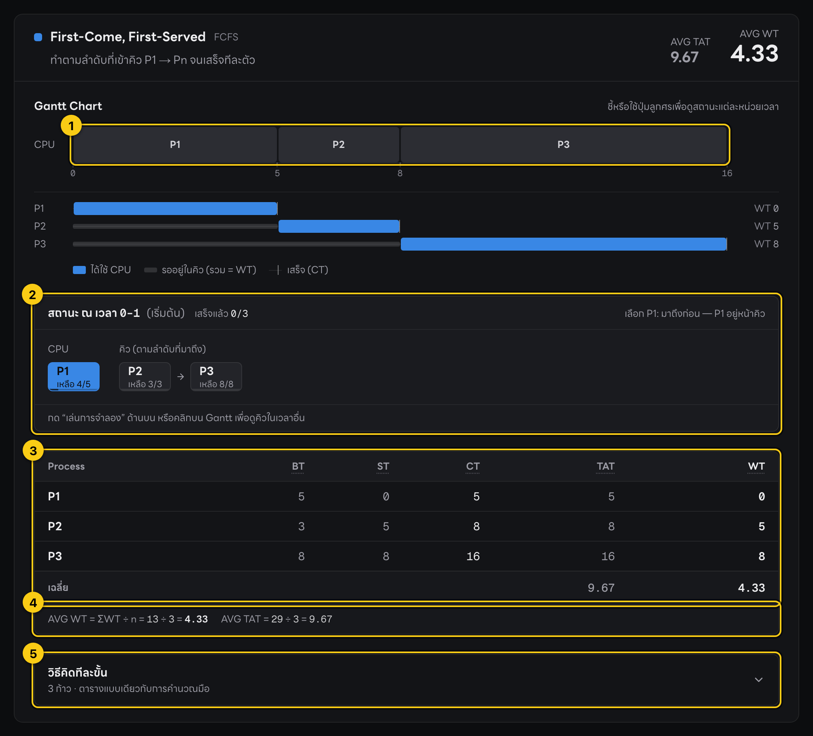

Gantt chart ของ Round Robin:

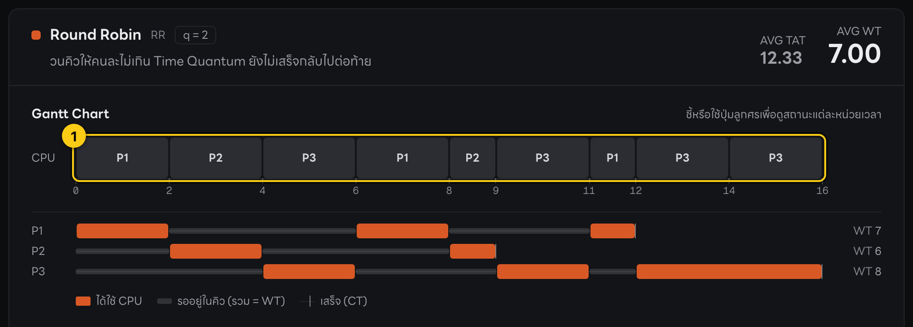

**วิธีอ่าน:**
- **แถว CPU** (กรอบ ①) — ช่องละช่วงเวลา ตัวเลขด้านล่างคือเวลาที่เริ่ม/จบ
- **แถว P1, P2, P3** ด้านล่าง — **แถบสีทึบ** = ช่วงที่ได้ใช้ CPU · **เส้นสีเทาจาง** = ช่วงที่นั่งรอในคิว · **ขีดตั้งปลายแถบ** = เวลาเสร็จ (CT)
- ความยาวเส้นเทารวมกัน = **WT** (ตัวเลขด้านขวา เช่น WT 7)

> 🎙️ **พูดในคลิป:**
> "ลองนึกภาพร้านข้าวที่มีพ่อครัวคนเดียว พ่อครัวก็คือซีพียู ลูกค้าก็คือโปรเซส ทุกคนมาถึงพร้อมกันที่เวลาศูนย์
> แบบแรก FCFS คือมาก่อนได้ก่อน ทำตามลำดับ P1 P2 P3 ทีละคนจนเสร็จ
> แบบที่สอง SJF คือทำงานที่สั้นที่สุดก่อน ถ้าเวลาเท่ากันก็เอาเลขโปรเซสน้อยกว่าก่อน แบบนี้ได้เวลารอเฉลี่ยน้อยที่สุด
> แบบที่สาม Round Robin คือผลัดกันทำคนละไม่เกิน Time Quantum ถ้ายังไม่เสร็จก็กลับไปต่อท้ายคิว ยุติธรรมกับทุกคน แต่สลับบ่อยเลยรอรวมนานกว่า"

---

## บทที่ 2: โครงสร้างโปรแกรม (เปรียบเป็นร้านอาหาร)

### 2.1 แต่ละส่วนทำหน้าที่อะไร

| ส่วนของร้าน | ในโปรแกรม | ไฟล์ |
|---|---|---|
| **หน้าร้าน** — ที่ลูกค้ากรอกออร์เดอร์ และที่เสิร์ฟผลลัพธ์ | หน้าเว็บ ฟอร์ม ตาราง กราฟ | `app/page.tsx`, `components/*.tsx` |
| **พนักงานตรวจออร์เดอร์** — ดูว่ากรอกครบ/ถูกไหม ก่อนส่งเข้าครัว | การตรวจค่าที่กรอก (กฎ E1–E7) | `lib/validation.ts` |
| **ผู้จัดการครัว** — รับออร์เดอร์ แจกงานให้พ่อครัวแต่ละสูตร แล้วสรุปผล | เรียกอัลกอริทึม + คิดสูตร TAT/WT/AVG WT | `lib/scheduling/simulate.ts` |
| **พ่อครัว 3 คน 3 สไตล์** | FCFS / SJF / Round Robin | `lib/scheduling/fcfs.ts`, `sjf.ts`, `rr.ts` |
| **แบบฟอร์มกลาง** — กำหนดว่าข้อมูลหน้าตาแบบไหน | รูปร่างข้อมูล | `lib/scheduling/types.ts` |
| **ฝ่ายตรวจคุณภาพ (QC)** — ชิมทุกจานก่อนเปิดร้าน | unit test 60 ข้อ | `tests/*.test.ts` |

**ประเด็นที่ควรพูด:** ครัว (`lib/`) **ไม่รู้เลยว่ามีหน้าร้าน** — รับตัวเลขเข้า คืนตัวเลขออกอย่างเดียว ข้อดีคือ
1. ตรวจความถูกต้องของสูตรได้โดยไม่ต้องเปิดเว็บ (unit test)
2. แก้หน้าตาเว็บได้โดยไม่กระทบการคำนวณ

### 2.2 แผนที่ไฟล์

```
app/
  page.tsx                  หน้าหลัก: เก็บค่าที่กรอก, ปุ่มคำนวณ, ส่งผลไปแสดง
components/                 ── หน้าร้าน ──
  SchedulingForm.tsx        ฟอร์มด้านซ้าย (จำนวนโปรเซส, BT, อัลกอริทึม, Quantum)
  ProcessTableInput.tsx     ช่องกรอก BT ของ P1…Pn
  ErrorSummary.tsx          กล่องแดงรวมข้อผิดพลาด
  ResultCard.tsx            การ์ดผลลัพธ์ 1 ใบต่อ 1 อัลกอริทึม
  ScheduleTimeline.tsx      Gantt chart
  ResultTable.tsx           ตาราง Process / BT / ST / CT / TAT / WT + สูตร AVG WT
  ComparisonSummary.tsx     แผง "เปรียบเทียบเวลารอ"
  QuantumSweep.tsx          กราฟ "Time Quantum มีผลอย่างไร"
  PlaybackBar.tsx           แถบเล่นการจำลอง
  QueueView.tsx             กล่อง "สถานะ ณ เวลา …" (ใครอยู่ CPU ใครอยู่ในคิว)
  StepTrace.tsx             ตาราง "วิธีคิดทีละขั้น"
lib/                        ── ครัว ──
  validation.ts             ตรวจค่าที่กรอก
  scheduling/
    types.ts                แบบฟอร์มข้อมูล
    fcfs.ts  sjf.ts  rr.ts  อัลกอริทึม 3 แบบ
    simulate.ts             ผู้จัดการครัว + สูตร TAT / WT / AVG WT
    trace.ts  timeline.ts   ตัวช่วยของฟีเจอร์เสริม (คิดทีละขั้น, กราฟ Quantum, ช่วงรอ)
tests/                      ── QC ──
  scheduling.test.ts  trace.test.ts  timeline.test.ts
```

### 2.3 เส้นทางของข้อมูล ตั้งแต่กดปุ่มจนเห็นผล

```
 [1] ผู้ใช้กดปุ่ม "คำนวณผลลัพธ์"
          │
          ▼
 [2] calculate()                       app/page.tsx บรรทัด 106
          │
          ▼
 [3] validateInput()  ── ผิด ──►  แสดงข้อความแดง แล้วหยุด      lib/validation.ts บรรทัด 37
          │ ถูก
          ▼
 [4] runSimulation()                   lib/scheduling/simulate.ts บรรทัด 53
          │  ส่ง BT ชุดเดียวกันให้ทุกอัลกอริทึมที่ติ๊กไว้
          ├──► simulateFcfs()   fcfs.ts  ─┐
          ├──► simulateSjf()    sjf.ts   ─┼─ คืน ST, CT, Gantt
          └──► simulateRr()     rr.ts    ─┘
          │
          ▼
 [5] finalize()  คิด TAT = CT, WT = TAT − BT, AVG WT     simulate.ts บรรทัด 18
          │
          ▼
 [6] หน้าจอแสดง: แผงเปรียบเทียบ, กราฟ Quantum, การ์ดผลลัพธ์ (Gantt + ตาราง)
```

ภาพรวมทั้งหน้าเว็บหลังกดคำนวณ (ซ้าย = ฟอร์ม, ขวา = ผลลัพธ์):


### 2.4 "แบบฟอร์มข้อมูล" ตรงกับหัวตารางในเว็บ — `lib/scheduling/types.ts` บรรทัด 16–26

ไฟล์นี้บอกว่าผลลัพธ์ของโปรเซส 1 ตัวมีอะไรบ้าง ซึ่ง **ตรงกับคอลัมน์ในตารางผลลัพธ์พอดี**

```ts
16 │ export interface ProcessResult {
17 │   id: number                 ← Process (1 = P1)
18 │   burstTime: number          ← BT
19 │   /** เวลาที่ได้ CPU ครั้งแรก */
20 │   startTime: number          ← ST
21 │   completionTime: number     ← CT
22 │   /** = CT - AT = CT (เพราะ AT = 0) */
23 │   turnaroundTime: number     ← TAT
24 │   /** = TAT - BT */
25 │   waitingTime: number        ← WT
26 │ }
```

(ลูกศร ← คือคำอธิบายที่คู่มือเติมให้ ไม่ได้อยู่ในไฟล์จริง)

> 🎙️ **พูดในคลิป:**
> "โปรแกรมแบ่งเป็นสองส่วน เหมือนร้านอาหารที่มีหน้าร้านกับครัว หน้าร้านคือโฟลเดอร์ components ทำหน้าที่รับค่าและแสดงผล ครัวคือโฟลเดอร์ lib ทำหน้าที่คำนวณอย่างเดียว
> พอกดคำนวณ ฟังก์ชัน calculate จะส่งค่าไปตรวจที่ validateInput ก่อน ถ้าผ่านก็ส่งต่อให้ runSimulation ซึ่งเรียกอัลกอริทึมที่เลือกไว้ด้วยข้อมูลชุดเดียวกัน แล้ว finalize คิดค่า Turnaround Time กับ Waiting Time ให้ทั้งหมด
> ข้อดีของการแยกแบบนี้คือเราทดสอบสูตรได้โดยไม่ต้องเปิดหน้าเว็บ"

---

## บทที่ 3: การรับข้อมูล และการกันค่าผิด

### 3.1 ฟอร์มด้านซ้าย — แต่ละเลขในภาพคืออะไร

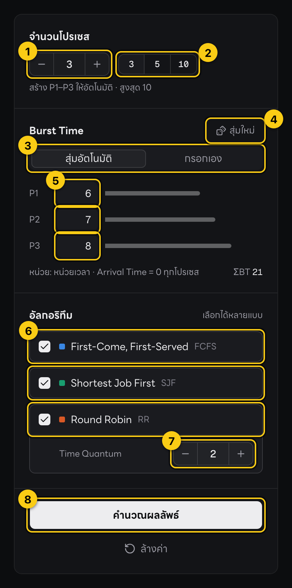

| เลข | คืออะไร | ทำงานยังไง | โค้ดอยู่ที่ |
|---|---|---|---|
| ① | ช่อง **จำนวนโปรเซส** + ปุ่ม − / + | พิมพ์หรือกด −/+ ได้ 1–10 · เปลี่ยนแล้วแถว P1…Pn ปรับตามทันที | `components/SchedulingForm.tsx` บรรทัด 175 · ปรับแถว: `app/page.tsx` บรรทัด 179 |
| ② | ปุ่มลัด **3 / 5 / 10** | กดทีเดียวได้จำนวนนั้นเลย | `SchedulingForm.tsx` บรรทัด 186 |
| ③ | แท็บ **สุ่มอัตโนมัติ / กรอกเอง** | เลือกว่า BT มาจากการสุ่มหรือพิมพ์เอง | `SchedulingForm.tsx` บรรทัด 223–229 |
| ④ | ปุ่ม **สุ่มใหม่** (มีเฉพาะโหมดสุ่ม) | สุ่ม BT ใหม่ทุกแถว | `SchedulingForm.tsx` บรรทัด 214 |
| ⑤ | ช่อง **Burst Time** ของ P1, P2, P3 | โหมดสุ่ม = แก้ไม่ได้ (อ่านอย่างเดียว) · โหมดกรอกเอง = พิมพ์ได้ · ใต้ตารางเขียนว่า "Arrival Time = 0 ทุกโปรเซส" | `components/ProcessTableInput.tsx` (ข้อความ AT บรรทัด 94) |
| ⑥ | เลือก **อัลกอริทึม** | ติ๊กได้หลายตัวพร้อมกัน | `SchedulingForm.tsx` |
| ⑦ | ช่อง **Time Quantum** | โผล่เมื่อติ๊ก Round Robin · ค่าเริ่มต้น 2 | `SchedulingForm.tsx` บรรทัด 291–305 |
| ⑧ | ปุ่ม **คำนวณผลลัพธ์** | ตรวจค่า → คำนวณ (กดแป้น ⌘+Enter / Ctrl+Enter ก็ได้) | `SchedulingForm.tsx` บรรทัด 323 → เรียก `calculate()` |

ปุ่มมุมขวาบนของเว็บ:


| เลข | ปุ่ม | ใช้ทำอะไร |
|---|---|---|
| ① | พิมพ์ | พิมพ์ / บันทึกผลเป็น PDF แนบรายงาน |
| ② | โหมดนำเสนอ | ตัวหนังสือใหญ่ เต็มจอ — **ใช้ตอนอัดคลิป** |
| ③ | ชุดตัวอย่าง SET-A | ใส่ P1 = 5, P2 = 3, P3 = 8, q = 2 แล้วคำนวณให้ทันที |

### 3.2 การสุ่ม Burst Time — `app/page.tsx` บรรทัด 25–27 [🔗](https://github.com/serlorsx-xln/cpu-scheduling-simulator/blob/main/app/page.tsx#L25-L27)

```ts
25 │ function randomBt(): string {
26 │   return String(1 + Math.floor(Math.random() * 10));
27 │ }
```

**อ่านบรรทัด 26 จากข้างในออกมาข้างนอก:**

| ขั้น | โค้ด | ตัวอย่าง (สุ่มได้ 0.73) | ค่าน้อยสุดที่เป็นไปได้ | ค่ามากสุดที่เป็นไปได้ |
|---|---|---|---|---|
| 1 | `Math.random()` สุ่มเลข 0 ถึงเกือบ 1 | 0.73 | 0 | 0.999… |
| 2 | `* 10` คูณ 10 | 7.3 | 0 | 9.99… |
| 3 | `Math.floor(…)` ปัดลง | 7 | 0 | 9 |
| 4 | `1 + …` บวก 1 | **8** | **1** | **10** |
| 5 | `String(…)` เปลี่ยนเป็นข้อความ | "8" | | |

ผลคือ **จำนวนเต็ม 1 ถึง 10 เสมอ** ไม่มีทางได้ 0 ติดลบ หรือทศนิยม

**ทำไมต้องเปลี่ยนเป็นข้อความ (ขั้น 5):** ช่องกรอกบนเว็บเก็บค่าเป็นข้อความ แบบเดียวกับที่คนพิมพ์ แล้วค่อยแปลงเป็นตัวเลขอีกทีตอนคำนวณ (`app/page.tsx` บรรทัด 121)

### 3.3 การกันค่าผิด — `lib/validation.ts`

ก่อนคำนวณทุกครั้ง โปรแกรมจะตรวจค่าก่อน ถ้าผิดแม้แต่จุดเดียว **จะไม่คำนวณเลย** แล้วขึ้นข้อความสีแดง 2 ที่: ใต้ช่องที่ผิด และกล่องรวมด้านบน

**หัวใจของการตรวจ คือฟังก์ชันเดียวนี้** — บรรทัด 21–23 [🔗](https://github.com/serlorsx-xln/cpu-scheduling-simulator/blob/main/lib/validation.ts#L21-L23)

```ts
21 │ function isPositiveInt(value: number): boolean {
22 │   return Number.isInteger(value) && value >= 1;
23 │ }
```

แปลว่า "ค่านี้ **เป็นจำนวนเต็ม** **และ** **มากกว่าหรือเท่ากับ 1** ใช่ไหม" (ตอบ จริง/เท็จ)

| ค่าที่ลองใส่ | เป็นจำนวนเต็ม? | ≥ 1? | ผ่าน? |
|---|---|---|---|
| 5 | ✓ | ✓ | **ผ่าน** |
| 0 | ✓ | ✗ | ไม่ผ่าน |
| −3 | ✓ | ✗ | ไม่ผ่าน |
| 2.5 | ✗ | ✓ | ไม่ผ่าน |
| abc (แปลงเป็นตัวเลขไม่ได้) | ✗ | ✗ | ไม่ผ่าน |

**กฎทั้ง 7 ข้อ (E1–E7)** — ฟังก์ชัน `validateInput` บรรทัด 37–93 [🔗](https://github.com/serlorsx-xln/cpu-scheduling-simulator/blob/main/lib/validation.ts#L37-L93)

| รหัส | กรณีที่ผิด | ข้อความที่ขึ้นบนจอ | บรรทัด |
|---|---|---|---|
| E1 | ไม่กรอกจำนวนโปรเซส | กรุณากรอกจำนวนโปรเซส | 41–42 |
| E2 | จำนวนโปรเซสเป็น 0, ติดลบ, ทศนิยม | จำนวนโปรเซสต้องเป็นจำนวนเต็มบวก | 43–44 |
| E3 | จำนวนโปรเซสมากกว่า 10 | จำนวนโปรเซสต้องไม่เกิน 10 | 45–46 |
| E4 | BT ของบางแถวผิด (0, ติดลบ, ทศนิยม) หรือว่างแถวเดียว | Burst Time ของ P_ ต้องเป็นจำนวนเต็มบวก | 59–76 |
| E5 | BT ว่างหลายแถว | กรุณากรอก Burst Time ให้ครบทุกโปรเซส | 57–58 |
| E6 | Time Quantum ผิด (ตรวจเฉพาะเมื่อติ๊ก RR) | Time Quantum ต้องเป็นจำนวนเต็มบวก | 80–85 |
| E7 | ไม่ติ๊กอัลกอริทึมเลย | กรุณาเลือกอัลกอริทึมอย่างน้อย 1 แบบ | 88–90 |

**ตัวอย่างโค้ดจริง: ตรวจจำนวนโปรเซส (E1–E3)** — บรรทัด 40–47

```ts
40 │   // E1–E3: จำนวนโปรเซส
41 │   if (raw.processCount === "") {
42 │     issues.push({ field: "processCount", message: "กรุณากรอกจำนวนโปรเซส" });
43 │   } else if (!isPositiveInt(raw.processCount)) {
44 │     issues.push({ field: "processCount", message: "จำนวนโปรเซสต้องเป็นจำนวนเต็มบวก" });
45 │   } else if (raw.processCount > MAX_PROCESSES) {
46 │     issues.push({ field: "processCount", message: `จำนวนโปรเซสต้องไม่เกิน ${MAX_PROCESSES}` });
47 │   }
```

| บรรทัด | แปลว่า |
|---|---|
| 41 | ถ้าช่องจำนวนโปรเซส **ว่าง** (`""` = ข้อความว่าง) … |
| 42 | … จดข้อผิดพลาดลงรายการ `issues` ว่า "กรุณากรอกจำนวนโปรเซส" (E1) |
| 43–44 | ไม่ว่าง แต่ **ไม่ใช่จำนวนเต็มบวก** (`!` = ไม่) → จด E2 |
| 45–46 | เป็นจำนวนเต็มบวก แต่ **มากกว่า 10** (`MAX_PROCESSES` ตั้งไว้ = 10 ที่บรรทัด 19) → จด E3 |

กฎอื่นเขียนแบบเดียวกัน: เช็กเงื่อนไข → ถ้าผิดก็ `issues.push(…)` จดข้อความไว้ บรรทัดสุดท้าย (92) คืนรายการข้อผิดพลาดทั้งหมด **ถ้ารายการว่าง = ผ่านทุกกฎ**

**ภาพจริง — กรอก P1 = 0, P2 = 2.5, P3 ว่าง, q = 0:**

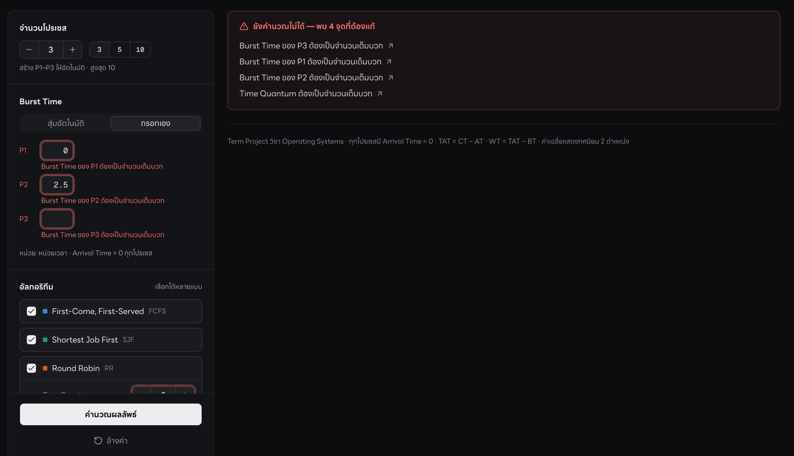

สังเกต: P3 (ว่าง) ขึ้นก่อน P1, P2 เพราะโค้ดตรวจ "แถวว่าง" ก่อน (บรรทัด 57–65) แล้วค่อยตรวจ "แถวที่กรอกแต่ค่าผิด" (บรรทัด 68–76)

**ภาพจริง — ลบจำนวนโปรเซส และไม่ติ๊กอัลกอริทึมเลย:**

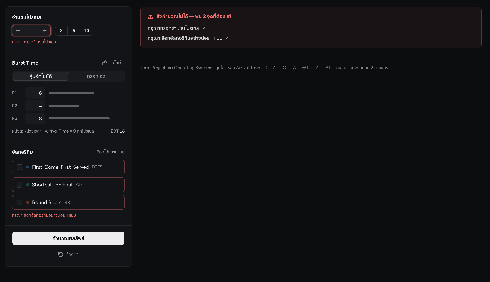

**เกร็ด: ทำไมฟอร์มมี `noValidate`** (`SchedulingForm.tsx` บรรทัด 144) — ปิดการเตือนอัตโนมัติของเบราว์เซอร์ (ซึ่งเป็นภาษาอังกฤษ หน้าตาต่างกันแต่ละเบราว์เซอร์ และจะบังข้อความของเรา) เพื่อให้ข้อความ E1–E7 ภาษาไทยของเราขึ้นแทนทุกครั้ง

> 🎙️ **พูดในคลิป:**
> "ผู้ใช้กำหนดจำนวนโปรเซสได้ตั้งแต่ 1 ถึง 10 โปรแกรมจะสร้าง P1 ถึง Pn ให้อัตโนมัติ ทุกตัวมี Arrival Time เป็นศูนย์
> Burst Time เลือกได้ว่าจะสุ่มหรือกรอกเอง ถ้าสุ่ม ฟังก์ชัน randomBt จะสุ่มจำนวนเต็ม 1 ถึง 10 ให้
> ถ้าเลือก Round Robin จะมีช่อง Time Quantum ค่าเริ่มต้นคือ 2
> ก่อนคำนวณทุกครั้ง validateInput จะตรวจว่าทุกค่าเป็นจำนวนเต็มบวก ถ้าผิด เช่น ใส่ศูนย์ ใส่ทศนิยม หรือเว้นว่าง จะขึ้นข้อความบอกว่าผิดที่ช่องไหน และจะไม่คำนวณ"
>
> **แล้วสาธิตบนเว็บ:** แท็บกรอกเอง → ใส่ P1 = 0 → กดคำนวณ → ชี้ข้อความแดง → แก้กลับ → ใส่ q = 0 → กดคำนวณ → ชี้ข้อความแดง

---

## บทที่ 4: โค้ดคำนวณ อ่านทีละบรรทัด

ทุกหัวข้อในบทนี้มี 4 ส่วน: **(ก)** สรุปภาษาคน → **(ข)** โค้ดจริง → **(ค)** แปลทีละบรรทัด → **(ง)** ลองเดินโค้ดด้วยตัวเลข SET-A ว่าค่าในกล่องเปลี่ยนยังไง

### 4.1 ปุ่มคำนวณ — `app/page.tsx` บรรทัด 106–130 [🔗](https://github.com/serlorsx-xln/cpu-scheduling-simulator/blob/main/app/page.tsx#L106-L130)

**(ก) ภาษาคน:** ตรวจค่าก่อน → ผิดก็โชว์ error แล้วหยุด → ถูกก็แปลงค่าจากฟอร์มเป็นตัวเลข แล้วส่งไปคำนวณ

**(ข) โค้ดจริง**

```ts
106 │   function calculate(input: RawFormInput, { scroll = true }: { scroll?: boolean } = {}) {
107 │     const issues = validateInput(input);
108 │     if (issues.length > 0) {
109 │       setErrors(issues);
110 │       setResults(null);
111 │       setComputedFrom(null);
112 │       return;
113 │     }
114 │
115 │     const n = input.processCount as number;
116 │     setErrors([]);
117 │     setResults(
118 │       runSimulation({
119 │         processes: Array.from({ length: n }, (_, i) => ({
120 │           id: i + 1,
121 │           burstTime: Number(input.burstTimes[i].trim()),
122 │         })),
123 │         timeQuantum: Number(input.timeQuantum.trim()),
124 │         algorithms: (["fcfs", "sjf", "rr"] as const)
125 │           .filter((key) => input.algorithms[key])
126 │           .map((key) => ALGORITHM_NAMES[key]),
127 │       })
128 │     );
129 │     setComputedFrom(fingerprint(input));
130 │     setRunId((id) => id + 1);
```

**(ค) แปลทีละบรรทัด**

| บรรทัด | แปลว่า |
|---|---|
| 106 | เริ่มฟังก์ชัน `calculate` รับค่าทั้งหมดจากฟอร์ม (`input`) |
| 107 | ส่งค่าไปตรวจ ได้รายการข้อผิดพลาดกลับมาเก็บใน `issues` |
| 108 | ถ้ามีข้อผิดพลาดอย่างน้อย 1 ข้อ … |
| 109 | … เอาข้อผิดพลาดไปโชว์บนจอ (คำสั่งที่ขึ้นต้นด้วย `set` = "อัปเดตค่าที่หน้าจอใช้ แล้วหน้าจอวาดใหม่เอง") |
| 110–111 | … ล้างผลลัพธ์เก่าทิ้ง |
| 112 | … **`return` = หยุดตรงนี้ ไม่คำนวณต่อ** |
| 115 | ผ่านการตรวจแล้ว: `n` = จำนวนโปรเซส |
| 116 | ล้างข้อความ error เก่า |
| 117–118 | คำนวณด้วย `runSimulation` แล้วเอาผลไปโชว์ |
| 119–122 | สร้างรายการโปรเซส n ตัว ตัวที่ i มี `id` = i + 1 (เลขโปรเซส) และ `burstTime` = ค่าที่กรอก แปลงจากข้อความเป็นตัวเลข (`Number`) ตัดช่องว่างหัวท้ายออกก่อน (`trim`) |
| 123 | Time Quantum แปลงเป็นตัวเลข |
| 124–126 | จากรายชื่อ fcfs, sjf, rr → **เก็บเฉพาะตัวที่ติ๊กไว้** (`filter`) → เปลี่ยนเป็นชื่อเต็ม "FCFS", "SJF", "RR" (`map`) |
| 129–130 | งานจุกจิกของหน้าจอ: จำไว้ว่าผลนี้คำนวณจากค่าชุดไหน (ถ้าแก้ฟอร์มทีหลัง เว็บจะเตือนว่าผลไม่ตรงกับฟอร์มแล้ว) และสั่งเริ่มแอนิเมชันใหม่ |

**(ง) ตัวอย่าง SET-A:** สิ่งที่ส่งให้ `runSimulation` คือ

```
processes:  [ {id: 1, burstTime: 5}, {id: 2, burstTime: 3}, {id: 3, burstTime: 8} ]
timeQuantum: 2
algorithms: [ "FCFS", "SJF", "RR" ]
```

### 4.2 ผู้จัดการครัว — `lib/scheduling/simulate.ts` บรรทัด 50–73 [🔗](https://github.com/serlorsx-xln/cpu-scheduling-simulator/blob/main/lib/scheduling/simulate.ts#L50-L73)

**(ก) ภาษาคน:** ดึง BT ออกมาเป็นแถวตัวเลข แล้ววนไล่ FCFS → SJF → RR ตัวไหนติ๊กไว้ก็สั่งคำนวณ แล้วส่งผลไปคิดสูตร (`finalize`)

**(ข) โค้ดจริง**

```ts
50 │ const allAlgorithms: AlgorithmName[] = ["FCFS", "SJF", "RR"];
51 │
52 │ /** เรียกอัลกอริทึมตามที่ผู้ใช้เลือก ด้วยชุดข้อมูลเดียวกัน เรียงผล FCFS, SJF, RR เสมอ */
53 │ export function runSimulation(input: SimulationInput): SimulationResult[] {
54 │   const bt = input.processes.map((p) => p.burstTime);
55 │   const results: SimulationResult[] = [];
56 │
57 │   for (const algorithm of allAlgorithms) {
58 │     if (!input.algorithms.includes(algorithm)) continue;
59 │     switch (algorithm) {
60 │       case "FCFS":
61 │         results.push(finalize("FCFS", bt, simulateFcfs(bt)));
62 │         break;
63 │       case "SJF":
64 │         results.push(finalize("SJF", bt, simulateSjf(bt)));
65 │         break;
66 │       case "RR":
67 │         results.push(finalize("RR", bt, simulateRr(bt, input.timeQuantum), input.timeQuantum));
68 │         break;
69 │     }
70 │   }
71 │
72 │   return results;
73 │ }
```

**(ค) แปลทีละบรรทัด**

| บรรทัด | แปลว่า |
|---|---|
| 50 | รายชื่ออัลกอริทึมทั้งหมด เรียงตายตัว FCFS, SJF, RR |
| 54 | ดึงเฉพาะ BT ของทุกโปรเซสออกมา → SET-A ได้ `bt = [5, 3, 8]` |
| 55 | เตรียมแถวว่างไว้ใส่ผลลัพธ์ |
| 57 | วนทีละอัลกอริทึม |
| 58 | ถ้าผู้ใช้ **ไม่ได้ติ๊ก** ตัวนี้ → `continue` = ข้ามไปตัวถัดไป |
| 59 | `switch` = เลือกทางตามชื่ออัลกอริทึม (เหมือนป้ายแยกทาง) |
| 61 | FCFS: ส่ง `bt` ให้ `simulateFcfs` → ได้ ST/CT/Gantt → ส่งต่อให้ `finalize` คิดสูตร → ใส่ผลลงแถว |
| 64 | SJF: แบบเดียวกัน |
| 67 | RR: แบบเดียวกัน แต่ส่ง Time Quantum ไปด้วย |
| 62, 65, 68 | `break` = จบทางแยกนี้ |
| 72 | คืนผลของทุกอัลกอริทึม |

**ประเด็นที่ควรพูด:** ทุกอัลกอริทึมได้ **`bt` แถวเดียวกัน** → เปรียบเทียบกันได้อย่างยุติธรรม

### 4.3 FCFS — `lib/scheduling/fcfs.ts` (ทั้งไฟล์) [🔗](https://github.com/serlorsx-xln/cpu-scheduling-simulator/blob/main/lib/scheduling/fcfs.ts#L1-L18)

**(ก) ภาษาคน:** ตั้งนาฬิกาที่ 0 แล้ววนตั้งแต่ P1 ถึง Pn: ตอนนี้กี่โมง = เวลาเริ่ม · บวก BT = เวลาเสร็จ · เลื่อนนาฬิกาไปตอนเสร็จ

**(ข) โค้ดจริง**

```ts
 1 │ import type { AlgorithmOutput } from "./types";
 2 │
 3 │ /** FCFS: รันตามลำดับเข้าระบบ P1 → Pn */
 4 │ export function simulateFcfs(burstTimes: number[]): AlgorithmOutput {
 5 │   const startTime: number[] = [];
 6 │   const completionTime: number[] = [];
 7 │   const gantt: AlgorithmOutput["gantt"] = [];
 8 │
 9 │   let t = 0;
10 │   for (let i = 0; i < burstTimes.length; i++) {
11 │     startTime[i] = t;
12 │     completionTime[i] = t + burstTimes[i];
13 │     gantt.push({ processId: i + 1, start: t, end: completionTime[i] });
14 │     t = completionTime[i];
15 │   }
16 │
17 │   return { startTime, completionTime, gantt };
18 │ }
```

**(ค) แปลทีละบรรทัด**

| บรรทัด | แปลว่า |
|---|---|
| 1 | ดึง "แบบฟอร์มข้อมูล" มาจากไฟล์ types |
| 4 | เริ่มฟังก์ชัน รับแถว BT เข้ามา |
| 5–7 | เตรียมแถวว่าง 3 แถว: เวลาเริ่ม, เวลาเสร็จ, ช่อง Gantt |
| 9 | **ตั้งนาฬิกา `t` ที่ 0** |
| 10 | วนทีละโปรเซส i = 0, 1, 2 (คือ P1, P2, P3) **ตามลำดับที่เข้ามา** |
| 11 | เวลาเริ่มของตัวนี้ = เวลาตอนนี้ |
| 12 | เวลาเสร็จ = เวลาตอนนี้ + BT ของมัน |
| 13 | วาดช่อง Gantt: P(i+1) ใช้ CPU จาก t ถึงเวลาเสร็จ |
| 14 | **เลื่อนนาฬิกาไปตอนตัวนี้เสร็จ** (ตัวถัดไปจะเริ่มตรงนี้) |
| 17 | คืนผล |

**(ง) เดินโค้ดด้วย SET-A** (`burstTimes = [5, 3, 8]`)

| รอบ | i (โปรเซส) | t ก่อน | บรรทัด 11: ST | บรรทัด 12: CT | บรรทัด 13: Gantt | บรรทัด 14: t หลัง |
|---|---|---|---|---|---|---|
| 1 | 0 (P1) | 0 | 0 | 0 + 5 = **5** | P1 [0–5] | 5 |
| 2 | 1 (P2) | 5 | 5 | 5 + 3 = **8** | P2 [5–8] | 8 |
| 3 | 2 (P3) | 8 | 8 | 8 + 8 = **16** | P3 [8–16] | 16 |
| — | i = 3 | | ไม่น้อยกว่า 3 แล้ว → **ออกจากลูป** | | | |

ผล: `startTime = [0, 5, 8]`, `completionTime = [5, 8, 16]` ✓ ตรงกับบทที่ 1

### 4.4 SJF — `lib/scheduling/sjf.ts` (ทั้งไฟล์) [🔗](https://github.com/serlorsx-xln/cpu-scheduling-simulator/blob/main/lib/scheduling/sjf.ts#L1-L23)

**(ก) ภาษาคน:** **เรียงคิวใหม่จาก BT น้อยไปมาก** ก่อน แล้วทำแบบเดียวกับ FCFS เป๊ะ ๆ บนคิวที่เรียงแล้ว

**(ข) โค้ดจริง**

```ts
 3 │ /** SJF Non-preemptive: เลือก BT น้อยสุดก่อน (เท่ากัน → เลขโปรเซสน้อยก่อน) */
 4 │ export function simulateSjf(burstTimes: number[]): AlgorithmOutput {
 5 │   // AT = 0 ทุกโปรเซส จึงเรียงลำดับครั้งเดียวแล้วรันแบบ FCFS บนลำดับใหม่ได้ผลเดียวกัน
 6 │   const order = burstTimes
 7 │     .map((bt, i) => ({ bt, i }))
 8 │     .sort((a, b) => a.bt - b.bt || a.i - b.i);
 9 │
10 │   const startTime: number[] = new Array(burstTimes.length);
11 │   const completionTime: number[] = new Array(burstTimes.length);
12 │   const gantt: AlgorithmOutput["gantt"] = [];
13 │
14 │   let t = 0;
15 │   for (const { bt, i } of order) {
16 │     startTime[i] = t;
17 │     completionTime[i] = t + bt;
18 │     gantt.push({ processId: i + 1, start: t, end: completionTime[i] });
19 │     t = completionTime[i];
20 │   }
21 │
22 │   return { startTime, completionTime, gantt };
23 │ }
```

**(ค) แปลทีละบรรทัด**

| บรรทัด | แปลว่า |
|---|---|
| 7 | ติดป้ายให้ BT แต่ละตัวว่า **มาจากช่องไหน** (`i`) จะได้ไม่ลืมว่าเป็นของ P อะไรหลังเรียง |
| 8 | **เรียง:** BT น้อยก่อน · ถ้า BT เท่ากัน → เลขช่องน้อยก่อน (= เลขโปรเซสน้อยก่อน) |
| 10–12 | เตรียมแถวว่าง (`new Array(3)` = แถวว่าง 3 ช่อง) |
| 14–20 | **เหมือน FCFS ทุกอย่าง** ต่างแค่วนตาม `order` ที่เรียงแล้ว และเก็บผลไว้ที่ **ช่องเดิมของโปรเซส** (`startTime[i]`) ตารางผลลัพธ์เลยยังเรียง P1, P2, P3 ตามปกติ |

**บรรทัด 8 ทำงานยังไง** — `.sort` จะหยิบทีละคู่ (a กับ b) มาถามว่า "ใครควรอยู่หน้า?"
- ผลลบ → a อยู่หน้า · ผลบวก → b อยู่หน้า · ศูนย์ → เท่ากัน
- `a.bt - b.bt` เช่น P2 (3) กับ P1 (5) → 3 − 5 = **−2** (ลบ) → P2 อยู่หน้า
- `|| a.i - b.i` ใช้ **เฉพาะตอน BT เท่ากัน** เพราะในภาษานี้ `0 || x` = x (ถ้าฝั่งซ้ายเป็น 0 ให้ไปใช้ฝั่งขวาแทน) → เทียบเลขช่อง → เลขน้อยอยู่หน้า
  - ตัวอย่าง BT = [4, 4, 4] → ทุกคู่ได้ 0 → ไปเทียบเลขช่อง → ได้ P1, P2, P3 (มี unit test ตรวจเรื่องนี้ไว้ — บท 6.4)

**ทำไมเรียงครั้งเดียวพอ (คอมเมนต์บรรทัด 5):** ทุกโปรเซสมาถึงเวลา 0 พร้อมกัน ไม่มีใครมาเพิ่มระหว่างทาง ลำดับที่เรียงไว้ตอนแรกจึงถูกตลอด

**(ง) เดินโค้ดด้วย SET-A**

บรรทัด 7 (ติดป้าย): `[ {bt: 5, i: 0}, {bt: 3, i: 1}, {bt: 8, i: 2} ]`
บรรทัด 8 (เรียง): `[ {bt: 3, i: 1}, {bt: 5, i: 0}, {bt: 8, i: 2} ]` → ลำดับ P2, P1, P3

| รอบ | หยิบ | t ก่อน | ST | CT | Gantt | t หลัง |
|---|---|---|---|---|---|---|
| 1 | bt 3, i 1 (P2) | 0 | startTime[1] = 0 | completionTime[1] = **3** | P2 [0–3] | 3 |
| 2 | bt 5, i 0 (P1) | 3 | startTime[0] = 3 | completionTime[0] = **8** | P1 [3–8] | 8 |
| 3 | bt 8, i 2 (P3) | 8 | startTime[2] = 8 | completionTime[2] = **16** | P3 [8–16] | 16 |

ผล (เรียงตามช่อง P1, P2, P3): `startTime = [3, 0, 8]`, `completionTime = [8, 3, 16]` ✓

### 4.5 Round Robin — `lib/scheduling/rr.ts` (ทั้งไฟล์) [🔗](https://github.com/serlorsx-xln/cpu-scheduling-simulator/blob/main/lib/scheduling/rr.ts#L1-L27)

**(ก) ภาษาคน:** มีคิว P1, P2, P3 · หยิบหัวคิวมา · ทำให้ไม่เกิน q · ถ้าเสร็จ จดเวลาเสร็จ · ถ้ายังไม่เสร็จ ส่งไปต่อท้ายคิว · ทำซ้ำจนคิวว่าง

**(ข) โค้ดจริง**

```ts
 3 │ /** RR: คิววนตามลำดับ P1→Pn รันได้ไม่เกิน quantum หน่วยต่อครั้ง ไม่จบกลับท้ายคิว */
 4 │ export function simulateRr(burstTimes: number[], quantum: number): AlgorithmOutput {
 5 │   const startTime: number[] = new Array(burstTimes.length).fill(-1);
 6 │   const completionTime: number[] = new Array(burstTimes.length);
 7 │   const gantt: AlgorithmOutput["gantt"] = [];
 8 │
 9 │   const remaining = [...burstTimes];
10 │   const queue = burstTimes.map((_, i) => i);
11 │
12 │   let t = 0;
13 │   while (queue.length > 0) {
14 │     const i = queue.shift() as number;
15 │     const runTime = Math.min(quantum, remaining[i]);
16 │
17 │     if (startTime[i] === -1) startTime[i] = t;
18 │     gantt.push({ processId: i + 1, start: t, end: t + runTime });
19 │     t += runTime;
20 │     remaining[i] -= runTime;
21 │
22 │     if (remaining[i] === 0) completionTime[i] = t;
23 │     else queue.push(i);
24 │   }
25 │
26 │   return { startTime, completionTime, gantt };
27 │ }
```

**(ค) แปลทีละบรรทัด**

| บรรทัด | แปลว่า |
|---|---|
| 4 | รับ BT และ **quantum** (q) |
| 5 | แถวเวลาเริ่ม ใส่ **−1** ทุกช่องไว้ก่อน = "ยังไม่เคยได้ CPU" |
| 9 | `remaining` = **เวลาที่ยังเหลือ** ของแต่ละตัว ถ่ายสำเนามาจาก BT (ตอนเริ่มเหลือเท่า BT) |
| 10 | `queue` = **คิว** เริ่มเป็น [0, 1, 2] คือ P1, P2, P3 |
| 12 | ตั้งนาฬิกาที่ 0 |
| 13 | **ทำซ้ำตราบใดที่คิวยังมีคน** |
| 14 | **หยิบหัวคิว** ออกมา (`shift`) |
| 15 | ⭐ **จะทำให้กี่หน่วย = ค่าที่น้อยกว่าระหว่าง q กับเวลาที่เหลือ** — เหลือมากกว่า q ทำ q · เหลือน้อยกว่า q ทำเท่าที่เหลือ (ไม่ทำเกิน) |
| 17 | ⭐ ถ้ายังเป็น −1 (ไม่เคยได้ CPU) → จดเวลาเริ่ม = ตอนนี้ · ถ้าเคยได้แล้ว **ไม่จดซ้ำ** → **ST = ครั้งแรกที่ได้ CPU** |
| 18 | วาดช่อง Gantt |
| 19 | เลื่อนนาฬิกาไปข้างหน้า `runTime` หน่วย |
| 20 | ลดเวลาที่เหลือลง `runTime` |
| 22 | ถ้าเหลือ 0 → **เสร็จแล้ว** จดเวลาเสร็จ |
| 23 | ⭐ ไม่อย่างนั้น → **ส่งกลับไปต่อท้ายคิว** (`push`) |

**(ง) เดินโค้ดด้วย SET-A, q = 2** — ดูว่าค่าในกล่องแต่ละใบเปลี่ยนยังไงทุกรอบ

| รอบ | คิวก่อนหยิบ | บ.14 หยิบ | t | บ.15 runTime | บ.17 ST | บ.18 Gantt | `remaining` หลังรอบ (P1, P2, P3) | บ.22–23 | คิวหลังรอบ |
|---|---|---|---|---|---|---|---|---|---|
| 1 | P1 P2 P3 | P1 | 0 | min(2, **5**) = 2 | ST P1 = **0** | P1 [0–2] | 3, 3, 8 | เหลือ 3 → ต่อท้าย | P2 P3 P1 |
| 2 | P2 P3 P1 | P2 | 2 | min(2, **3**) = 2 | ST P2 = **2** | P2 [2–4] | 3, 1, 8 | เหลือ 1 → ต่อท้าย | P3 P1 P2 |
| 3 | P3 P1 P2 | P3 | 4 | min(2, **8**) = 2 | ST P3 = **4** | P3 [4–6] | 3, 1, 6 | เหลือ 6 → ต่อท้าย | P1 P2 P3 |
| 4 | P1 P2 P3 | P1 | 6 | min(2, **3**) = 2 | (มีแล้ว ข้าม) | P1 [6–8] | 1, 1, 6 | เหลือ 1 → ต่อท้าย | P2 P3 P1 |
| 5 | P2 P3 P1 | P2 | 8 | min(2, **1**) = **1** | (ข้าม) | P2 [8–9] | 1, **0**, 6 | **เสร็จ CT P2 = 9** | P3 P1 |
| 6 | P3 P1 | P3 | 9 | min(2, **6**) = 2 | (ข้าม) | P3 [9–11] | 1, 0, 4 | เหลือ 4 → ต่อท้าย | P1 P3 |
| 7 | P1 P3 | P1 | 11 | min(2, **1**) = **1** | (ข้าม) | P1 [11–12] | **0**, 0, 4 | **เสร็จ CT P1 = 12** | P3 |
| 8 | P3 | P3 | 12 | min(2, **4**) = 2 | (ข้าม) | P3 [12–14] | 0, 0, 2 | เหลือ 2 → ต่อท้าย | P3 |
| 9 | P3 | P3 | 14 | min(2, **2**) = 2 | (ข้าม) | P3 [14–16] | 0, 0, **0** | **เสร็จ CT P3 = 16** | (ว่าง) |
| — | (ว่าง) | | | | | | | **คิวว่าง → ออกจากลูป (บ.13)** | |

ผล: `startTime = [0, 2, 4]`, `completionTime = [12, 9, 16]` ✓ ตรงกับบทที่ 1

ตารางนี้ **เหมือนตาราง "วิธีคิดทีละขั้น" ในเว็บทุกแถว** (บท 5.3) ใช้โชว์คู่กันในคลิปได้

### 4.6 คำนวณ TAT, WT, AVG WT — `lib/scheduling/simulate.ts` บรรทัด 12–48 [🔗](https://github.com/serlorsx-xln/cpu-scheduling-simulator/blob/main/lib/scheduling/simulate.ts#L12-L48)

**(ก) ภาษาคน:** อัลกอริทึมให้แค่ ST กับ CT มา ส่วนนี้คิดที่เหลือทั้งหมด **ที่จุดเดียว ใช้ร่วมกันทั้ง 3 อัลกอริทึม**
- TAT = CT − AT = CT (เพราะ AT = 0)
- WT = TAT − BT
- AVG WT = ผลรวม WT ÷ จำนวนโปรเซส ปัดทศนิยม 2 ตำแหน่ง

**(ข) โค้ดจริง**

```ts
12 │ /** ปัดเป็นทศนิยม 2 ตำแหน่ง เพื่อให้ค่าที่แสดงและค่าที่ทดสอบเป็นตัวเดียวกัน */
13 │ function round2(value: number): number {
14 │   return Math.round(value * 100) / 100;
15 │ }
16 │
17 │ /** คำนวณ TAT/WT/AVG จากผลดิบ — สูตรของโจทย์ทำที่จุดเดียว (AT = 0 → TAT = CT) */
18 │ function finalize(
19 │   algorithm: AlgorithmName,
20 │   burstTimes: number[],
21 │   output: AlgorithmOutput,
22 │   timeQuantum?: number
23 │ ): SimulationResult {
24 │   const processes: ProcessResult[] = burstTimes.map((bt, i) => {
25 │     const turnaroundTime = output.completionTime[i]; // CT - AT, AT = 0
26 │     return {
27 │       id: i + 1,
28 │       burstTime: bt,
29 │       startTime: output.startTime[i],
30 │       completionTime: output.completionTime[i],
31 │       turnaroundTime,
32 │       waitingTime: turnaroundTime - bt,
33 │     };
34 │   });
35 │
36 │   const n = burstTimes.length;
37 │   const sumTat = processes.reduce((acc, p) => acc + p.turnaroundTime, 0);
38 │   const sumWt = processes.reduce((acc, p) => acc + p.waitingTime, 0);
39 │
40 │   return {
41 │     algorithm,
42 │     ...(timeQuantum !== undefined ? { timeQuantum } : {}),
43 │     processes,
44 │     avgWaitingTime: round2(sumWt / n),
45 │     avgTurnaroundTime: round2(sumTat / n),
46 │     gantt: output.gantt,
47 │   };
48 │ }
```

**(ค) แปลทีละบรรทัด**

| บรรทัด | แปลว่า |
|---|---|
| 13–15 | `round2` = ปัดเป็นทศนิยม 2 ตำแหน่ง: คูณ 100 → ปัดเป็นจำนวนเต็ม → หาร 100 |
| 18–23 | `finalize` รับ: ชื่ออัลกอริทึม, BT, ผลดิบจากอัลกอริทึม (ST/CT/Gantt), และ q (เฉพาะ RR — `?` แปลว่าไม่ส่งก็ได้) |
| 24 | ทำทีละโปรเซส (`map`) สร้างแถวผลลัพธ์ 1 แถวต่อ 1 โปรเซส |
| 25 | ⭐ **TAT = CT** (คอมเมนต์บอกว่ามาจาก CT − AT และ AT = 0) |
| 27–31 | ใส่เลขโปรเซส, BT, ST, CT, TAT ลงแถว |
| 32 | ⭐ **WT = TAT − BT** |
| 36 | `n` = จำนวนโปรเซส |
| 37–38 | รวม TAT ทุกตัว และรวม WT ทุกตัว (`reduce` = เริ่มจาก 0 แล้วบวกทีละตัว) |
| 42 | ถ้าเป็น RR ใส่ค่า q ติดไปด้วย (เพื่อโชว์ "q = 2" บนการ์ด) |
| 44 | ⭐ **AVG WT = ผลรวม WT ÷ n** แล้วปัด 2 ตำแหน่ง |
| 45 | AVG TAT คิดแบบเดียวกัน |

**(ง) เดินโค้ดด้วย RR ของ SET-A** (CT = [12, 9, 16], BT = [5, 3, 8])

| โปรเซส | บ.25 TAT = CT | บ.32 WT = TAT − BT |
|---|---|---|
| P1 | 12 | 12 − 5 = **7** |
| P2 | 9 | 9 − 3 = **6** |
| P3 | 16 | 16 − 8 = **8** |

- บ.38: sumWt = 0 + 7 + 6 + 8 = **21**
- บ.44: 21 ÷ 3 = 7 → round2(7) = **7** → บนจอโชว์ **7.00**

ตัวอย่างการปัด (SJF): sumWt = 11 → 11 ÷ 3 = 3.6666… → ×100 = 366.66… → ปัด = 367 → ÷100 = **3.67**

**ทำไมสูตรอยู่ที่นี่ ไม่ได้อยู่ในแต่ละอัลกอริทึม:** เขียนสูตรครั้งเดียว ใช้ร่วมกันทั้งสามแบบ → ไม่มีทางที่ FCFS คิด WT แบบหนึ่ง แต่ RR คิดอีกแบบ

**ทำไมต้องปัดด้วย `round2`:** ให้ค่าที่โชว์บนจอกับค่าที่ unit test ตรวจเป็นตัวเดียวกันพอดี

> 🎙️ **พูดในคลิป (เปิดไฟล์ rr.ts):**
> "นี่คือหัวใจของ Round Robin เริ่มจากคิว P1 P2 P3 ในลูป while เราหยิบหัวคิวออกมา บรรทัด 15 คำนวณว่าจะรันกี่หน่วย คือค่าที่น้อยกว่าระหว่าง Quantum กับเวลาที่เหลือ บรรทัด 17 บันทึก Start Time เฉพาะครั้งแรกที่ได้ซีพียู จากนั้นลดเวลาที่เหลือ ถ้าเหลือศูนย์ก็บันทึก Completion Time ถ้ายังเหลือก็ push กลับไปท้ายคิว วนจนคิวว่าง"
>
> 🎙️ **พูดในคลิป (เปิดไฟล์ simulate.ts):**
> "หลังจากอัลกอริทึมให้เวลาเริ่มกับเวลาเสร็จมาแล้ว ฟังก์ชัน finalize คิดค่าที่เหลือในที่เดียว บรรทัด 25 Turnaround Time เท่ากับ Completion Time เพราะ Arrival Time เป็นศูนย์ บรรทัด 32 Waiting Time เท่ากับ Turnaround Time ลบ Burst Time และบรรทัด 44 ค่าเฉลี่ยคือผลรวม Waiting Time หารจำนวนโปรเซส ปัดทศนิยมสองตำแหน่ง"

---

## บทที่ 5: การแสดงผลบนหน้าจอ

### 5.1 การ์ดผลลัพธ์ (1 ใบต่อ 1 อัลกอริทึม)


| เลข | ส่วน | อ่านยังไง | ไฟล์ |
|---|---|---|---|
| (หัวการ์ด) | ชื่อ + AVG WT ตัวใหญ่ | ดูตรงนี้เร็วสุดว่าวิธีนี้รอเฉลี่ยเท่าไร | `components/ResultCard.tsx` |
| ① | Gantt chart | ใครได้ CPU ช่วงไหน (ดูวิธีอ่านที่บท 1.4) | `components/ScheduleTimeline.tsx` |
| ② | สถานะ ณ เวลา … | ใครอยู่ใน CPU ใครรอในคิว ณ เวลานั้น (บท 5.4) | `components/QueueView.tsx` |
| ③ | ตารางผลลัพธ์ | Process / BT / ST / CT / TAT / WT · แถวล่าง "เฉลี่ย" | `components/ResultTable.tsx` |
| ④ | บรรทัดสูตร | **AVG WT = ΣWT ÷ n = 13 ÷ 3 = 4.33** — โชว์ที่มาของตัวเลข ตรวจด้วยมือได้ทันที | `ResultTable.tsx` บรรทัด 127–136 |
| ⑤ | วิธีคิดทีละขั้น | กดเปิดดูตารางแบบคำนวณมือ (บท 5.3) | `components/StepTrace.tsx` |

**เกร็ด:** เอาเมาส์ชี้ที่หัวคอลัมน์ (BT, ST, CT, TAT, WT) จะมีคำอธิบายเด้งขึ้นมา เช่น "Waiting Time = TAT − BT" (ข้อความกำหนดไว้ที่ `ResultTable.tsx` บรรทัด 19–25)

### 5.2 อ่านตาราง 1 แถว (ใช้พูดในคลิป)

ตารางของ Round Robin:

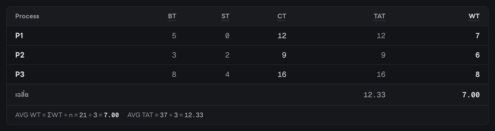

แถว **P1**:
- **BT = 5** → ต้องใช้ CPU ทั้งหมด 5 หน่วย
- **ST = 0** → ได้ CPU ครั้งแรกที่เวลา 0
- **CT = 12** → ทำเสร็จที่เวลา 12
- **TAT = 12** → อยู่ในระบบ 12 − 0 = 12 หน่วย
- **WT = 7** → อยู่ในระบบ 12 หน่วย ได้ใช้ CPU จริงแค่ 5 → **นั่งรอ 7 หน่วย**

> ⚠️ **ข้อควรรู้เรื่องคอลัมน์ AT:** โจทย์ให้ตารางมีคอลัมน์ Process / **AT** / BT / ST / CT / TAT / WT แต่ตารางบนเว็บตอนนี้ **ไม่มีคอลัมน์ AT แยก** เพราะ AT = 0 ทุกตัว (บอกไว้ใต้ช่องกรอก BT และใน tooltip ของ TAT แทน) ถ้าอยากให้ตรงแบบฟอร์มของโจทย์เป๊ะ ให้บอกทีมเพิ่มคอลัมน์ **ก่อนอัด** (แก้ไม่กี่บรรทัดใน `ResultTable.tsx`)

### 5.3 วิธีคิดทีละขั้น (ตารางแบบคำนวณมือ)

กดแถบ "วิธีคิดทีละขั้น" ด้านล่างการ์ด (เลข ⑤ ในภาพบท 5.1) จะกางออกเป็นตารางนี้ (ภาพของ Round Robin):

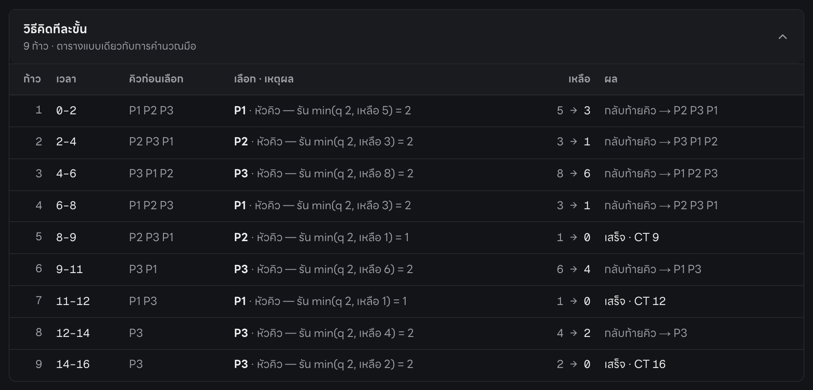

| คอลัมน์ | ความหมาย |
|---|---|
| ก้าว | ครั้งที่เท่าไรที่ CPU เลือกโปรเซส |
| เวลา | ช่วงเวลาที่รัน |
| คิวก่อนเลือก | ใครรออยู่ในคิวบ้าง เรียงจากหัว |
| เลือก · เหตุผล | เลือกใคร เพราะอะไร เช่น "หัวคิว — รัน min(q 2, เหลือ 5) = 2" (ตรงกับบรรทัด 14–15 ของ `rr.ts`) |
| เหลือ | เวลาที่เหลือ ก่อน → หลัง |
| ผล | กลับท้ายคิว (และคิวใหม่) หรือ เสร็จ · CT |

**ตารางนี้กับตารางเดินโค้ดในบท 4.5 ตรงกันทุกแถว** — โชว์สองอย่างนี้คู่กันในคลิปจะเห็นชัดว่าโค้ดทำงานตามที่คิดด้วยมือ

### 5.4 เล่นการจำลอง และดูคิวทีละหน่วยเวลา

แถบด้านบนสุดของฝั่งผลลัพธ์:


| เลข | ปุ่ม | ทำอะไร |
|---|---|---|
| ① | เล่น / หยุด | เวลาเดินเองทีละหน่วย **ทุกอัลกอริทึมพร้อมกัน** |
| ② | ถอย / ไป ทีละหน่วย | ก้าวทีละ 1 หน่วยเวลา (ใช้ตอนอธิบายช้า ๆ) |
| ③ | แถบเลื่อนเวลา | ลากไปเวลาไหนก็ได้ · ตัวเลขข้างขวาบอกเวลาปัจจุบัน เช่น 5–6 / 16 |
| ④ | ความเร็ว | 0.5× / 1× / 2× / 4× |

กล่อง "สถานะ ณ เวลา …" ของ Round Robin ตอนเวลา 5–6:

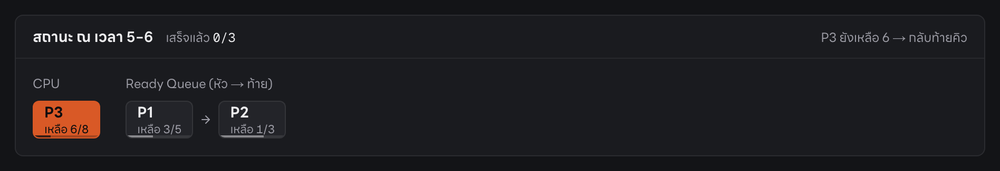

อ่านว่า: ตอนนี้ **P3 อยู่ใน CPU** (เหลือ 6 จาก 8 หลังหน่วยนี้) · ในคิวรอ **P1 → P2** · มุมขวาบอกว่า "P3 ยังเหลือ 6 → กลับท้ายคิว" — ตรงกับรอบที่ 3 ในตารางบท 4.5 พอดี

### 5.5 แผงเปรียบเทียบเวลารอ

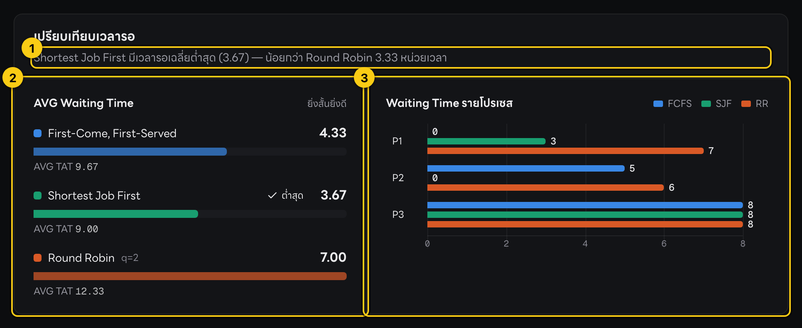

| เลข | ส่วน | อ่านยังไง |
|---|---|---|
| ① | ประโยคสรุป | โปรแกรมเขียนให้เองจากตัวเลขจริง: "Shortest Job First มีเวลารอเฉลี่ยต่ำสุด (3.67) — น้อยกว่า Round Robin 3.33 หน่วยเวลา" |
| ② | AVG Waiting Time | แท่งยิ่งสั้นยิ่งดี · ตัวที่ดีที่สุดมีป้าย ✓ ต่ำสุด |
| ③ | Waiting Time รายโปรเซส | ดูว่าแต่ละโปรเซสรอเท่าไรในแต่ละวิธี เช่น P2 รอ 5 ใน FCFS แต่ 0 ใน SJF |

ประโยคสรุปสร้างจากโค้ด `components/ComparisonSummary.tsx` บรรทัด 14–31: เรียง AVG WT จากน้อยไปมาก → ตัวแรก = ดีสุด ตัวท้าย = แย่สุด → เอาผลต่างมาเขียนเป็นประโยค

> 🎙️ **พูดในคลิป:**
> "ผลลัพธ์แต่ละอัลกอริทึมแสดงเป็นการ์ด ด้านบนคือ Gantt chart แถบสีทึบคือช่วงที่ได้ใช้ซีพียู เส้นสีเทาคือช่วงที่รอ ด้านล่างคือตาราง Start Time, Completion Time, Turnaround Time และ Waiting Time ใต้ตารางแสดงสูตร Average Waiting Time พร้อมตัวเลขจริง เช่น 13 หาร 3 ได้ 4.33
> กดวิธีคิดทีละขั้นจะเห็นทุกก้าวเหมือนที่เราคำนวณมือ และกดเล่นการจำลองเพื่อดูว่าแต่ละหน่วยเวลาใครได้ซีพียู ใครรออยู่ในคิว"

---

## บทที่ 6: การทดสอบ

โจทย์ข้อ 1.6 ให้ทดสอบอย่างน้อย 3 กรณี + ตรวจกับการคำนวณมืออย่างน้อย 1 กรณี

### 6.1 T1 — กรอกค่าเอง และเทียบกับการคำนวณมือ

**ทำบนจอ:** กดปุ่ม **ชุดตัวอย่าง SET-A** มุมขวาบน (โค้ด: ค่าตั้งไว้ที่ `app/page.tsx` บรรทัด 47–52 · ปุ่มเรียก `handleLoadSample` บรรทัด 198 ซึ่งใส่ค่าลงฟอร์มแล้วสั่งคำนวณทันที)

```ts
47 │ const SET_A: RawFormInput = {
48 │   processCount: 3,
49 │   burstTimes: ["5", "3", "8"],
50 │   timeQuantum: "2",
51 │   algorithms: { fcfs: true, sjf: true, rr: true },
52 │ };
```

**ต้องเห็นบนจอ (ตรงกับคำนวณมือในบทที่ 1 และ `docs/07-HAND-CALCULATION.md` ทุกช่อง):**

| | ST (P1, P2, P3) | CT (P1, P2, P3) | WT (P1, P2, P3) | AVG WT |
|---|---|---|---|---|
| FCFS | 0, 5, 8 | 5, 8, 16 | 0, 5, 8 | **4.33** |
| SJF | 3, 0, 8 | 8, 3, 16 | 3, 0, 8 | **3.67** |
| RR (q = 2) | 0, 2, 4 | 12, 9, 16 | 7, 6, 8 | **7.00** |

### 6.2 T2 — ค่าสุ่ม

**ทำบนจอ:** กดปุ่มลัด **10** → แท็บ **สุ่มอัตโนมัติ** → กด **สุ่มใหม่** → กด **คำนวณผลลัพธ์**

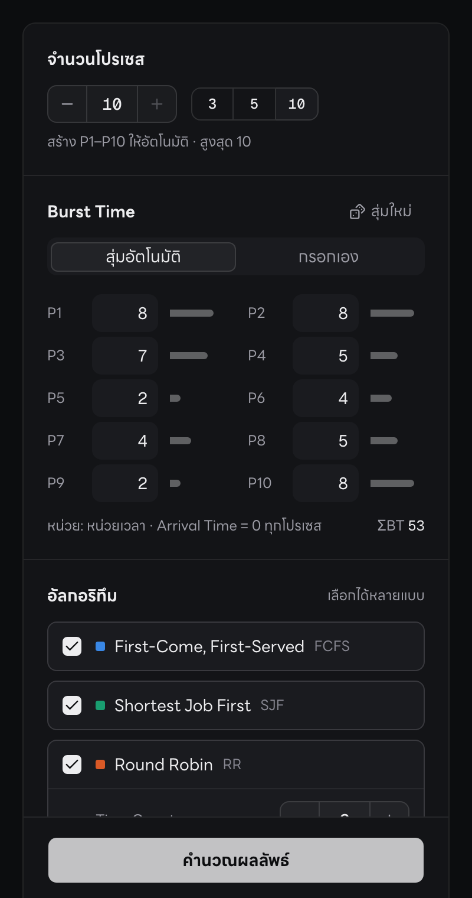

ตัวอย่างตาราง FCFS ที่ได้ (ค่าสุ่ม ตัวเลขจะไม่ตรงกับตอนอัด):

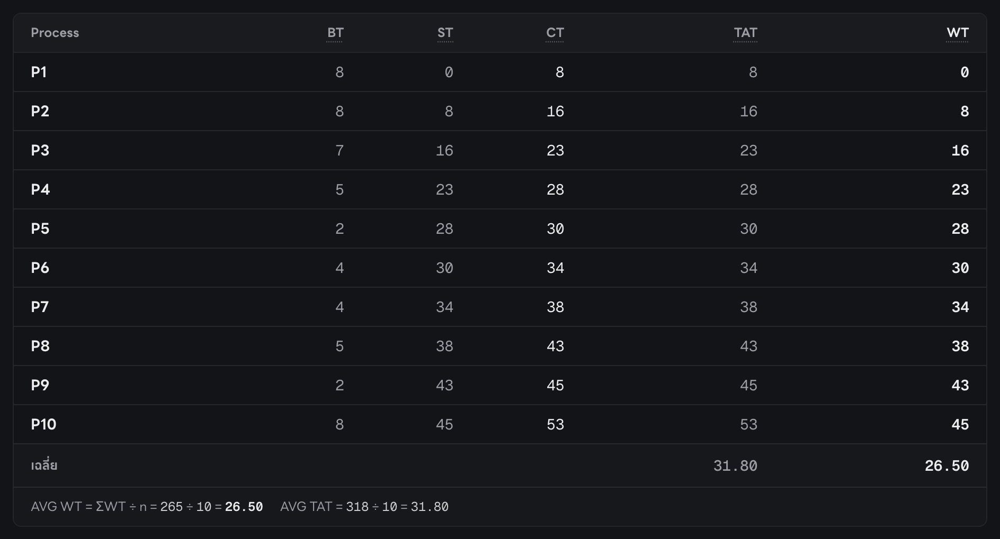

**วิธีพิสูจน์ว่าถูกโดยไม่ต้องคิดทั้งตาราง (พูดในคลิปได้เลย):**
1. **ตารางครบ P1–P10** ไม่มีช่องว่าง → ทุกโปรเซสได้ทำงานจนเสร็จ
2. **CT ที่มากที่สุด = ผลรวม BT ทั้งหมด** (ค่า ΣBT โชว์อยู่ใต้ช่องกรอก) → เพราะทุกตัวมาตั้งแต่เวลา 0 CPU จึงไม่เคยว่างเลย · ในภาพตัวอย่าง ΣBT = 53 และ CT ของ P10 = 53 พอดี
3. **ทุกแถว TAT = CT และ WT = TAT − BT** → สุ่มเลือกตรวจ 1–2 แถวด้วยมือก็พอ
4. **ทุก WT ≥ 0** (ไม่มีใครรอติดลบ)

### 6.3 T3 — ข้อมูลเดิม เปลี่ยน Quantum

**ทำบนจอ:** กด SET-A → แก้ Time Quantum เป็น 1, 3, 4 แล้วกดคำนวณทีละครั้ง (หรือคลิกจุดบนกราฟ Quantum — บทที่ 7)

| q | 1 | **2** | 3 | 4 | 5 ขึ้นไป |
|---|---|---|---|---|---|
| AVG WT ของ RR | 6.67 | **7.00** | 5.67 | 6.33 | 4.33 |

ต้องเห็น: AVG WT ของ RR เปลี่ยนตาม q · ส่วน FCFS กับ SJF **ไม่เปลี่ยน** (ไม่ได้ใช้ q) · Gantt ของทุกค่า q จบที่เวลา 16 เท่ากัน (= ผลรวม BT)

### 6.4 Unit test — "QC อัตโนมัติ" 60 ข้อ

**Unit test คืออะไร:** โปรแกรมเล็ก ๆ ที่เรียกฟังก์ชันของเราด้วยค่าที่รู้คำตอบอยู่แล้ว แล้วเช็กว่าได้คำตอบตรงไหม — เหมือนเฉลยข้อสอบที่ตรวจอัตโนมัติ

**ตัวอย่างจริง** — `tests/scheduling.test.ts` บรรทัด 40–49 [🔗](https://github.com/serlorsx-xln/cpu-scheduling-simulator/blob/main/tests/scheduling.test.ts#L40-L49)

```ts
40 │   it("U-F1: SET-A ได้ ST/CT/WT ตรงค่าคำนวณมือ", () => {
41 │     const out = simulateFcfs(SET_A);
42 │     expect(out.startTime).toEqual([0, 5, 8]);
43 │     expect(out.completionTime).toEqual([5, 8, 16]);
44 │     expect(out.gantt).toEqual([
45 │       { processId: 1, start: 0, end: 5 },
46 │       { processId: 2, start: 5, end: 8 },
47 │       { processId: 3, start: 8, end: 16 },
48 │     ]);
49 │   });
```

| บรรทัด | แปลว่า |
|---|---|
| 40 | ชื่อการทดสอบ: "SET-A ได้ ST/CT/WT ตรงค่าคำนวณมือ" |
| 41 | เรียก FCFS ด้วย [5, 3, 8] |
| 42 | **คาดหวังว่า (`expect`)** เวลาเริ่ม **ต้องเท่ากับ** [0, 5, 8] |
| 43 | เวลาเสร็จต้องเท่ากับ [5, 8, 16] |
| 44–48 | Gantt ต้องเป็น 3 ช่องนี้เป๊ะ ๆ |

อีกตัวอย่าง — ตรวจกฎ "BT เท่ากันให้เลขโปรเซสน้อยก่อน" ของ SJF (บรรทัด 71–75):

```ts
71 │   it("U-S2: BT เท่ากันหมด tie-break ด้วยเลขโปรเซส", () => {
72 │     const out = simulateSjf([4, 4, 4]);
73 │     expect(out.completionTime).toEqual([4, 8, 12]);
74 │     expect(out.gantt.map((g) => g.processId)).toEqual([1, 2, 3]);
75 │   });
```

**มีทั้งหมด 60 ข้อ ผ่านทั้งหมด**

| ไฟล์ | จำนวน | ตรวจอะไร |
|---|---|---|
| `tests/scheduling.test.ts` | 23 | FCFS / SJF / RR ตรงคำนวณมือ, กรณีพิเศษ (โปรเซสเดียว, BT เท่ากัน, q ใหญ่มาก, q = 1), สูตร TAT/WT/AVG, การตรวจค่าผิด E1–E7 |
| `tests/trace.test.ts` | 15 | ตาราง "วิธีคิดทีละขั้น" ตรงกับ Gantt จริง (สุ่มเทียบ 300 ชุด) |
| `tests/timeline.test.ts` | 11 | ช่วงรอรวมกัน = WT, ตัวช่วยวาดแกนเวลา |

รันด้วยคำสั่ง `npm run test` (ดูภาคผนวก) ผลลัพธ์ท้ายสุดจะขึ้น `Tests  60 passed (60)`
และ **test รันอัตโนมัติทุกครั้งก่อนขึ้นเว็บจริง** — ถ้ามีข้อไหนไม่ผ่าน เว็บจะไม่ถูกอัปเดต

> 🎙️ **พูดในคลิป:**
> "เราทดสอบสามแบบ แบบแรกกรอกค่าเองด้วยชุด SET-A ที่เราคำนวณมือไว้ ผลตรงกันทุกช่อง FCFS 4.33 SJF 3.67 Round Robin 7.00
> แบบที่สองสุ่มสิบโปรเซส ตรวจได้ว่าทุกโปรเซสทำงานครบ และเวลาเสร็จของตัวสุดท้ายเท่ากับผลรวม Burst Time พอดี
> แบบที่สามใช้ข้อมูลเดิมแต่เปลี่ยน Quantum ผลของ Round Robin เปลี่ยนตาม ส่วน FCFS กับ SJF เท่าเดิม
> นอกจากนี้ยังมี unit test อัตโนมัติ 60 ข้อ ตรวจสูตรทุกครั้งก่อนขึ้นเว็บจริง"

---

## บทที่ 7: เปรียบเทียบเมื่อ Burst Time หรือ Quantum เปลี่ยน

### 7.1 กราฟ "Time Quantum มีผลอย่างไร"

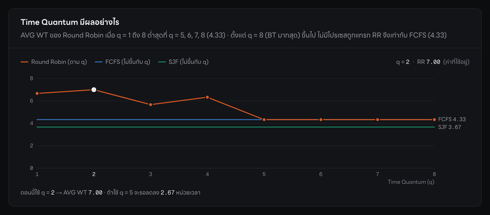

**อ่านกราฟ:**
- **แกนนอน** = ค่า q (1 ถึง 8) · **แกนตั้ง** = เวลารอเฉลี่ย
- **เส้นส้ม** = Round Robin ที่แต่ละค่า q · **จุดขาว** = ค่า q ที่ใช้อยู่ตอนนี้ (q = 2)
- **เส้นน้ำเงิน / เขียว** = FCFS / SJF (เป็นเส้นตรง เพราะไม่ขึ้นกับ q) เอาไว้เทียบ
- **คลิกจุดไหนบนกราฟ = คำนวณใหม่ด้วย q นั้นทันที** (`app/page.tsx` บรรทัด 155)
- ประโยคด้านล่างกราฟเขียนให้เองว่าถ้าเปลี่ยน q จะดีขึ้นเท่าไร

**โค้ดที่สร้างกราฟ** — `lib/scheduling/trace.ts` บรรทัด 129–139 [🔗](https://github.com/serlorsx-xln/cpu-scheduling-simulator/blob/main/lib/scheduling/trace.ts#L129-L139)

```ts
129 │ export function quantumSweep(burstTimes: number[], qMax = Math.max(...burstTimes)): QuantumPoint[] {
130 │   const processes = burstTimes.map((bt, i) => ({ id: i + 1, burstTime: bt }));
131 │   return Array.from({ length: Math.max(1, qMax) }, (_, i) => {
132 │     const [rr] = runSimulation({ processes, timeQuantum: i + 1, algorithms: ["RR"] });
133 │     return {
134 │       quantum: i + 1,
135 │       avgWaitingTime: rr.avgWaitingTime,
136 │       avgTurnaroundTime: rr.avgTurnaroundTime,
137 │     };
138 │   });
139 │ }
```

| บรรทัด | แปลว่า |
|---|---|
| 129 | รับ BT · `qMax` = ค่า q สูงสุดที่จะลอง ค่าเริ่มต้น = BT ที่มากที่สุด (SET-A = 8) |
| 131 | ทำซ้ำ qMax รอบ (q = 1, 2, …, 8) |
| 132 | ⭐ **เรียก `runSimulation` ตัวเดียวกับปุ่มคำนวณ** ให้คำนวณเฉพาะ RR ด้วย q นั้น |
| 134–136 | เก็บค่า q และเวลารอเฉลี่ยที่ได้ไว้เป็นจุด 1 จุดบนกราฟ |

**ทำไมสำคัญ:** กราฟไม่ได้ใช้สูตรประมาณ แต่ **รันโปรแกรมจริงทุกค่า q** ตัวเลขบนกราฟจึงตรงกับการ์ดผลลัพธ์เสมอ (ถ้า q ปัจจุบันมากกว่า BT สูงสุด กราฟจะยืดไปถึง q นั้น สูงสุด 100 — `components/QuantumSweep.tsx` บรรทัด 43)

### 7.2 Quantum มีผลอย่างไร (SET-A)

| q | 1 | 2 | 3 | 4 | 5 | 6 | 7 | 8 |
|---|---|---|---|---|---|---|---|---|
| AVG WT ของ RR | 6.67 | **7.00 (แย่สุด)** | 5.67 | 6.33 | **4.33** | 4.33 | 4.33 | 4.33 |

**3 ข้อที่ควรพูด:**

1. **q เล็กมาก → สลับบ่อย ทุกคนรอกันหลายรอบ** เวลารอสูง
2. **q ใหญ่พอ → RR กลายเป็น FCFS** ตั้งแต่ q = 5 ขึ้นไป P1 (5) กับ P2 (3) ทำเสร็จในรอบเดียว ไม่ต้องกลับไปต่อคิว ลำดับเลยเหมือน FCFS ทุกอย่าง ได้ 4.33 เท่ากัน
3. **ไม่ใช่ว่า q ยิ่งใหญ่ยิ่งดีเสมอ** — q = 3 (5.67) ดีกว่า q = 4 (6.33) เพราะขึ้นกับว่า q **"ตัด" งานแต่ละตัวตรงไหน**
   - q = 3: P1 ถูกตัดตอนเหลือ 2 → รอ P2 (3) กับ P3 (3) แล้วทำต่อ → **เสร็จที่ 11**
   - q = 4: P1 ถูกตัดตอนเหลือแค่ 1 → แต่ต้องรอ P2 (3) กับ P3 (4) นานกว่า → **เสร็จที่ 12** · P2 ก็เสร็จช้าลงด้วย (6 → 7) เพราะรอบแรกต้องรอ P1 นาน 4 แทน 3
   - q = 2 แย่สุด เพราะทั้ง P1 และ P2 ถูกตัดก่อนเสร็จ ต้องกลับไปรอ P3 หลายรอบ

### 7.3 Burst Time เปลี่ยน ผลเปลี่ยนอย่างไร (q = 2)

| ชุดข้อมูล (P1, P2, P3) | FCFS | SJF | RR | อธิบาย |
|---|---|---|---|---|
| **5, 3, 8** (SET-A) | 4.33 | **3.67** | 7.00 | ค่าตั้งต้น |
| **10**, 3, 8 (P1 ยาวขึ้น) | 7.67 ↑ | **4.67** | 9.33 ↑ | งานยาวอยู่หน้าคิว → FCFS แย่ลงมาก (convoy effect: ทุกคนต้องรอ P1 ที่นาน 10) · SJF ยังดีสุดเพราะย้าย P1 ไปไว้ท้าย |
| 5, 3, **1** (P3 สั้นลง) | 4.33 | **1.67** ↓ | 4.33 | งานสั้นอยู่ท้ายคิว → FCFS ไม่ได้ประโยชน์เลย · SJF ดึง P3 มาทำก่อน เวลารอลดฮวบ |

**สรุปปิดคลิป:**
- **SJF ได้เวลารอเฉลี่ยต่ำสุดเสมอ** เมื่อทุกโปรเซสมาพร้อมกัน
- **FCFS ขึ้นกับลำดับที่มา** — ถ้างานยาวมาก่อน ทุกคนรอนาน
- **RR ขึ้นกับการเลือก q** — แลกเวลารอเฉลี่ยกับความยุติธรรมและการได้เริ่มเร็ว

> 🎙️ **พูดในคลิป:**
> "ถ้าเปลี่ยนข้อมูล เช่น ให้ P1 ยาวขึ้นเป็น 10 FCFS แย่ลงจาก 4.33 เป็น 7.67 เพราะทุกคนต้องรองานยาวที่อยู่หน้าสุด แต่ SJF ยังดีที่สุดเพราะย้ายงานยาวไปไว้ท้าย
> ส่วน Quantum ของ Round Robin กราฟนี้คำนวณทุกค่า q ด้วยโค้ดจริง จะเห็นว่า q เล็กทำให้สลับบ่อยและรอนาน แต่ไม่ใช่ว่ายิ่งใหญ่ยิ่งดีเสมอ ขึ้นกับว่า q ตัดงานตรงไหน และเมื่อ q ใหญ่พอ Round Robin จะทำงานเหมือน FCFS คลิกจุดบนกราฟเพื่อคำนวณใหม่ด้วย q นั้นได้ทันที"

---

## บทที่ 8: สคริปต์ถ่ายคลิป ทีละฉาก

เวลาเป็นค่าแนะนำ (รวมราว 12–15 นาที) ปรับได้ตามที่อาจารย์กำหนด

### ก่อนกดอัด

- [ ] เปิด https://cpu-scheduling.s3rx.net แล้วกด **โหมดนำเสนอ** (ตัวใหญ่ อ่านง่ายในคลิป)
- [ ] เปิด VS Code (หรือหน้า GitHub ของโปรเจกต์) ขยายตัวหนังสือ (⌘ + / Ctrl + +)
- [ ] เตรียมแท็บไฟล์ไว้: `rr.ts`, `fcfs.ts`, `sjf.ts`, `simulate.ts`, `validation.ts`
- [ ] (ถ้าจะโชว์ test) เปิด Terminal ที่โฟลเดอร์โปรเจกต์ไว้
- [ ] ตัดสินใจเรื่องคอลัมน์ AT (บท 5.2) ให้เรียบร้อย

### ฉากต่อฉาก

| ฉาก | เวลา | หน้าจอ | ทำอะไร | พูดอะไร |
|---|---|---|---|---|
| 1 | 1 นาที | เว็บหน้าแรก | แนะนำตัว + โปรแกรม | "โปรแกรมนี้จำลองการจัดตารางซีพียูสามแบบ เพื่อเปรียบเทียบว่าแบบไหนทำให้โปรเซสรอน้อยที่สุด ทุกโปรเซสมาถึงพร้อมกันที่เวลาศูนย์" |
| 2 | 2 นาที | เว็บ (หรือสไลด์) | อธิบาย 3 อัลกอริทึมด้วยตัวอย่างร้านข้าว | บทพูดท้ายบท 1 |
| 3 | 1 นาที | VS Code แถบไฟล์ | ชี้โฟลเดอร์ components / lib / tests | บทพูดท้ายบท 2 |
| 4 | 2–3 นาที | VS Code | เปิด `fcfs.ts` → `sjf.ts` → **`rr.ts`** ชี้บรรทัด 15, 17, 23 ของ rr | บทพูดท้ายบท 4 (rr.ts) · fcfs: "วนตามลำดับ เวลาเริ่มคือเวลาปัจจุบัน เวลาเสร็จคือเริ่มบวก BT" · sjf: "เรียงตาม BT ก่อน แล้วทำแบบ FCFS" |
| 5 | 1–2 นาที | เว็บ + `validation.ts` | ชี้ฟอร์มทีละช่อง (ภาพบท 3.1) → สาธิตใส่ P1 = 0 และ q = 0 ให้ขึ้น error | บทพูดท้ายบท 3 |
| 6 | 2 นาที | เว็บ + `simulate.ts` | กด **SET-A** → ชี้ Gantt → ชี้ตาราง → อ่านแถว P1 ของ RR (บท 5.2) → ชี้สูตรใต้ตาราง → เปิดไฟล์ simulate.ts บรรทัด 25, 32, 44 | บทพูดท้ายบท 4 (simulate.ts) + บท 5 |
| 7 | 1 นาที | เว็บ | เปิด "วิธีคิดทีละขั้น" ของ RR · กด "เล่นการจำลอง" ให้เห็นคิวเปลี่ยน | "ตารางนี้คือทุกก้าวที่โปรแกรมเลือกโปรเซส เหมือนที่เราคำนวณมือ" |
| 8 | 1–2 นาที | เว็บ | **T2:** ปุ่ม 10 → สุ่มใหม่ → คำนวณ → ชี้ CT สุดท้าย = ΣBT | บทพูดท้ายบท 6 |
| 9 | 30 วินาที | Terminal | (ถ้ามี) รัน `npm run test` ให้เห็น 60 passed | "นอกจากนี้ยังมี unit test 60 ข้อ ผ่านทั้งหมด" |
| 10 | 2 นาที | เว็บ | **T3:** กด SET-A → คลิกจุด q = 1, 3, 5 บนกราฟ → แก้ P1 เป็น 10 แล้วคำนวณ | บทพูดท้ายบท 7 |
| 11 | 30 วินาที | แผงเปรียบเทียบ | สรุป | "สรุปคือ SJF ได้เวลารอเฉลี่ยต่ำสุดเมื่อทุกโปรเซสมาพร้อมกัน FCFS ขึ้นกับลำดับที่มา และ Round Robin ขึ้นกับการเลือก Quantum" |

### เคล็ดลับ

- ใช้ **SET-A** เป็นหลัก ตัวเลขจะเหมือนในคู่มือทุกครั้ง (ค่าสุ่มจะเปลี่ยนทุกรอบ)
- กด **⌘ + Enter / Ctrl + Enter** แทนการคลิกปุ่มคำนวณได้
- อธิบาย RR ให้ใช้ปุ่ม **ไปทีละหน่วย** (บท 5.4 เลข ②) ทีละคลิก แล้วพูดตามตารางบท 1.3 จะเห็นภาพที่สุด
- เอาเมาส์ชี้แถบใน Gantt หรือแถวในตาราง โปรเซสนั้นจะถูกไฮไลต์ทุกกราฟพร้อมกัน

---

## บทที่ 9: คำถามที่อาจารย์อาจถาม

**ถาม: Start Time ของ Round Robin คืออะไร ในเมื่อโปรเซสได้ CPU หลายครั้ง?**
ตอบ: คือเวลาที่ได้ CPU **ครั้งแรก** ครับ ในโค้ด `rr.ts` บรรทัด 17 จะบันทึก Start Time เฉพาะตอนที่ยังเป็น −1 คือยังไม่เคยได้รันเท่านั้น

**ถาม: ถ้า Burst Time เท่ากันใน SJF เลือกตัวไหน?**
ตอบ: เลือกเลขโปรเซสน้อยกว่าก่อนครับ อยู่ใน `sjf.ts` บรรทัด 8 ถ้า BT เท่ากันจะไปเทียบเลขโปรเซสแทน และมี unit test ตรวจกรณีนี้ (BT = 4, 4, 4 ต้องได้ลำดับ P1, P2, P3)

**ถาม: ทำไม Turnaround Time เท่ากับ Completion Time?**
ตอบ: เพราะ TAT = CT − AT และโจทย์กำหนดให้ Arrival Time เป็นศูนย์ทุกโปรเซส CT ลบศูนย์ก็เท่ากับ CT ครับ (`simulate.ts` บรรทัด 25)

**ถาม: ถ้าเวลาที่เหลือน้อยกว่า Quantum ทำยังไง?**
ตอบ: รันเท่าที่เหลือ ไม่รันเต็ม Quantum ครับ ใช้ `Math.min(quantum, remaining[i])` ที่ `rr.ts` บรรทัด 15 เช่น P2 เหลือ 1 ตอนเวลา 8 ก็รันแค่ 8 ถึง 9

**ถาม: ป้องกันการกรอกค่าผิดยังไง?**
ตอบ: ฟังก์ชัน `validateInput` ตรวจก่อนคำนวณทุกครั้ง มี 7 กฎ ทุกค่าต้องเป็นจำนวนเต็มบวก จำนวนโปรเซสไม่เกิน 10 และต้องเลือกอัลกอริทึมอย่างน้อย 1 แบบ ถ้าผิดจะขึ้นข้อความบอกว่าผิดที่ไหน และไม่คำนวณเลย

**ถาม: รู้ได้ยังไงว่าโปรแกรมคำนวณถูก?**
ตอบ: สามทางครับ หนึ่ง เทียบชุด SET-A กับการคำนวณมือ ตรงทุกช่อง สอง unit test 60 ข้อที่ตรวจทั้งค่าที่คำนวณมือไว้และกฎทั่วไป เช่น WT = TAT − BT สาม test รันอัตโนมัติก่อนขึ้นเว็บทุกครั้ง ถ้าผิดเว็บจะไม่อัปเดต

**ถาม: ทำไม SJF ได้เวลารอเฉลี่ยน้อยที่สุด?**
ตอบ: เพราะทำงานสั้นก่อน งานสั้นจึงรอน้อย คนที่ต้องรอนานมีแค่งานยาวที่อยู่ท้าย ซึ่งมีจำนวนน้อย

**ถาม: Quantum เท่าไรดีที่สุด?**
ตอบ: ไม่มีค่าตายตัวครับ ขึ้นกับชุดข้อมูล ดูได้จากกราฟ Quantum ในโปรแกรม ชุด SET-A ใช้ q ตั้งแต่ 5 ขึ้นไปได้เวลารอต่ำสุด แต่ q ใหญ่เกินไป Round Robin ก็จะเหมือน FCFS และเสียข้อดีเรื่องการตอบสนองที่เร็ว

**ถาม: ทำไม Round Robin ถึงรอนานกว่า ทั้งที่ดูยุติธรรมกว่า?**
ตอบ: เพราะทุกโปรเซสถูกตัดแบ่งเป็นช่วงสั้น ๆ แล้วต้องกลับไปต่อคิว เลยรอหลายรอบ แลกกับข้อดีที่ทุกโปรเซสได้เริ่มเร็ว ในชุด SET-A ทุกตัวได้ CPU ภายในเวลา 4

**ถาม: ทำไมใน SJF เรียงครั้งเดียวพอ ไม่ต้องเลือกใหม่ทุกครั้ง?**
ตอบ: เพราะทุกโปรเซสมาพร้อมกันที่เวลาศูนย์ ไม่มีโปรเซสใหม่เข้ามาระหว่างทาง ลำดับที่เรียงไว้ตอนแรกจึงถูกต้องตลอด (คอมเมนต์ใน `sjf.ts` บรรทัด 5)

**ถาม: ใช้ AI ช่วยตรงไหนบ้าง?** — ตอบในวิดีโอส่วนที่ 3 · ดูตาราง "Use of AI" ใน `README.md`

---

## บทที่ 10: ศัพท์ที่ต้องรู้

| ศัพท์ | ความหมายแบบง่าย | ในตัวอย่างร้านข้าว |
|---|---|---|
| CPU | ตัวประมวลผล ทำได้ทีละงาน | พ่อครัว |
| Process (P1, P2, …) | งานที่ต้องใช้ CPU | ลูกค้า |
| AT — Arrival Time | เวลาที่งานมาถึง (โปรแกรมนี้ = 0 ทุกตัว) | เวลาที่ลูกค้าเดินเข้าร้าน |
| BT — Burst Time | เวลาที่งานต้องใช้ CPU ทั้งหมด | เวลาที่ใช้ทำอาหารของลูกค้าคนนั้น |
| ST — Start Time | เวลาที่ได้ CPU ครั้งแรก | เวลาที่พ่อครัวเริ่มทำของคนนั้นครั้งแรก |
| CT — Completion Time | เวลาที่งานเสร็จ | เวลาที่ได้อาหารครบ |
| TAT — Turnaround Time | ตั้งแต่มาถึงจนเสร็จ = CT − AT | อยู่ในร้านนานเท่าไร |
| WT — Waiting Time | เวลาที่รอโดยไม่ได้ใช้ CPU = TAT − BT | นั่งรอเฉย ๆ นานเท่าไร |
| AVG WT | WT เฉลี่ยของทุกงาน — ยิ่งน้อยยิ่งดี | ลูกค้ารอเฉลี่ยกี่นาที |
| Time Quantum (q) | เวลาสูงสุดต่อรอบใน Round Robin | ทำให้คนละไม่เกินกี่นาที |
| Ready Queue | คิวงานที่พร้อมรัน รอ CPU ว่าง | แถวลูกค้าที่รอ |
| Gantt chart | แถบแสดงว่าช่วงไหนใครได้ CPU | ตารางเวรของพ่อครัว |
| Non-preemptive | ได้ CPU แล้วทำจนเสร็จ ไม่ถูกขัด (FCFS, SJF) | ทำของใครก็ทำจนเสร็จ |
| Preemptive | ถูกพักกลางคันได้ (RR พักเมื่อครบ q) | ทำได้ไม่เกิน q นาทีแล้วต้องสลับ |
| Convoy effect | งานยาวอยู่หน้า งานสั้นข้างหลังรอนานกันหมด | ลูกค้าคนแรกสั่งโต๊ะจีน คนสั่งไข่เจียวต้องรอ |
| Unit test | โปรแกรมเล็ก ๆ ที่ตรวจคำตอบของฟังก์ชันอัตโนมัติ | ฝ่าย QC ชิมทุกจาน |
| Validation | การตรวจค่าที่กรอกว่าถูกต้องก่อนใช้ | พนักงานเช็กออร์เดอร์ก่อนส่งครัว |

---

## ภาคผนวก: เปิดโค้ดและรันโปรแกรมในเครื่อง

### ดูโค้ดโดยไม่ต้องติดตั้งอะไร

เปิด https://github.com/serlorsx-xln/cpu-scheduling-simulator แล้วกดเข้าโฟลเดอร์/ไฟล์ได้เลย หรือกดลิงก์ 🔗 ในคู่มือนี้ จะเปิดไฟล์และไฮไลต์บรรทัดที่อ้างถึงให้

### เปิดใน VS Code

1. ไปที่ไฟล์: กด **⌘ + P** (Mac) / **Ctrl + P** (Windows) แล้วพิมพ์ชื่อไฟล์ เช่น `rr.ts` แล้ว Enter
2. ไปที่บรรทัด: กด **Ctrl + G** แล้วพิมพ์เลขบรรทัด เช่น `15`
3. ขยายตัวหนังสือสำหรับอัดคลิป: **⌘ + =** / **Ctrl + =**

### รันในเครื่อง (ถ้าจะโชว์ unit test)

ต้องติดตั้ง [Node.js](https://nodejs.org) รุ่น 20 ขึ้นไปก่อน แล้วเปิด Terminal ที่โฟลเดอร์โปรเจกต์:

```bash
npm install        # ติดตั้งครั้งแรกครั้งเดียว
npm run test       # รัน unit test → ต้องขึ้น "Tests  60 passed (60)"
npm run dev        # เปิดเว็บในเครื่องที่ http://localhost:3000 (ไม่จำเป็น ใช้เว็บจริงแทนได้)
```
